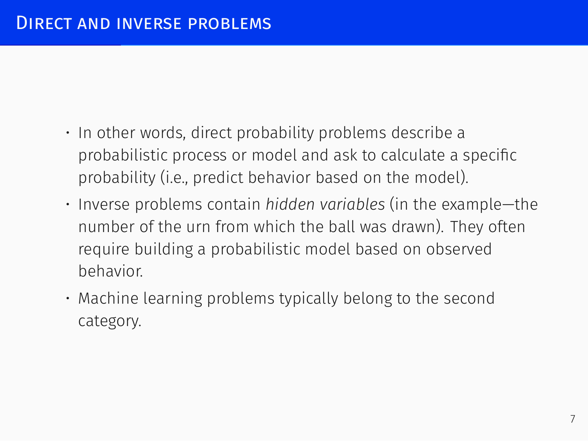
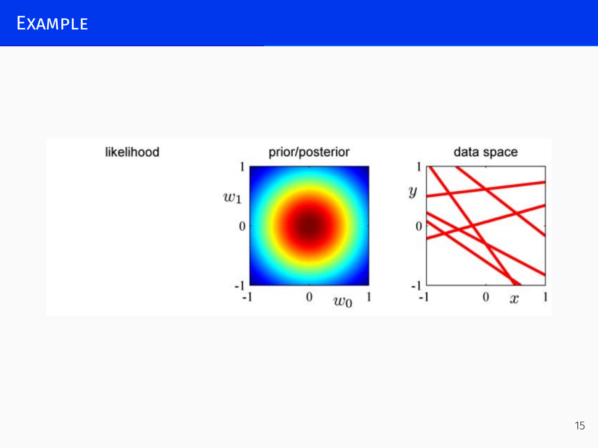
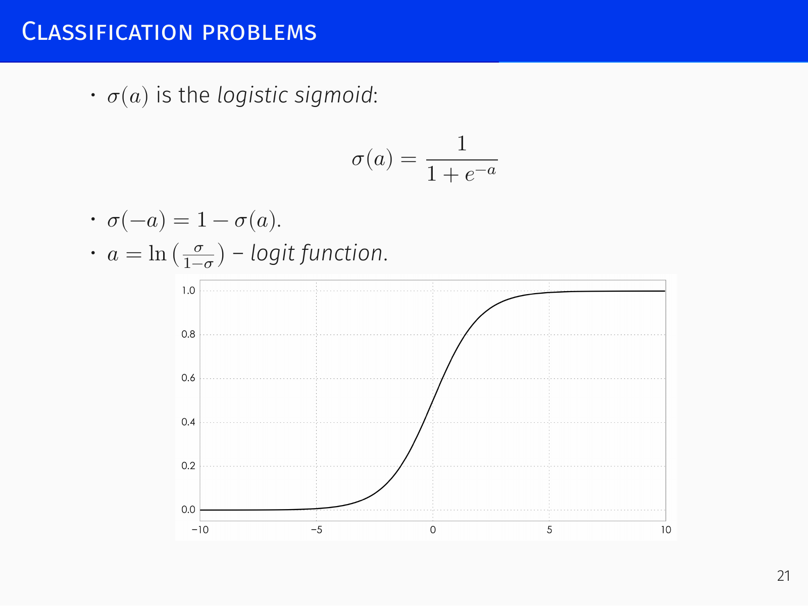
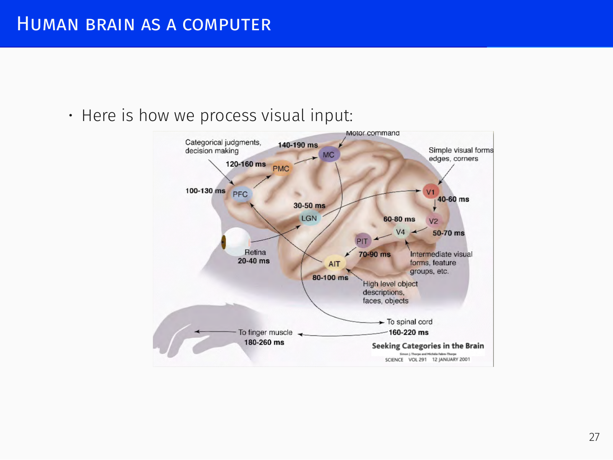

# Linear Models and Intro to Deep Learning

## Bayesian Approach to Machine Learning *[01:13]*

### Probabilistic Reminders and Bayes’ Theorem

In machine learning we constantly update our beliefs about model parameters in light of data. The central tool is **Bayes’ rule** for parameters and data:

> $$p(\theta\mid D) = \frac{p(\theta)\,p(D\mid\theta)}{p(D)},$$
> where  
> * $p(\theta)$ – prior probability,  
> * $p(D\mid\theta)$ – likelihood,  
> * $p(\theta\mid D)$ – posterior probability,  
> * $p(D) = \int p(D\mid\theta)\,p(\theta)\,d\theta$ – evidence (marginal likelihood).

From Bayes’ rule spring the three most important optimisation problems in machine learning:

1. **Maximum likelihood (ML):** $\theta_{\text{ML}} = \arg\max_\theta p(D\mid\theta)$ – ignore the prior, use only the data.
2. **Maximum a posteriori (MAP):** $\theta_{\text{MAP}} = \arg\max_\theta p(\theta\mid D) = \arg\max_\theta p(D\mid\theta)\,p(\theta)$ – combine data with prior knowledge.
3. **Full posterior predictive distribution:** average predictions over all plausible parameter values weighted by their posterior probability.

In practice we often stop at the MAP point estimate; deep learning strongly relies on this shortcut, though it discards the richness of the full distribution.

The underlying probability calculus is built on a few definitions (for discrete or continuous variables):
- **Joint probability:** $p(x, y)$
- **Marginalisation:** $p(x) = \sum_y p(x, y)$
- **Conditional probability:** $p(x\mid y)$; the chain rule gives $p(x, y) = p(x\mid y)\,p(y)$.
- **Independence:** $x$ and $y$ are independent if $p(x,y)=p(x)\,p(y)$.

### Frequentist and Bayesian Interpretations *[06:31]*

Two views of probability coexist:

- **Classical (frequentist):** probability is the limiting frequency of an outcome in infinitely repeatable experiments (coin tosses, dice rolls).
- **Bayesian:** probability quantifies a **degree of belief**. This is the only meaningful interpretation for unique, non‑repeatable events:  
  * a bookmaker setting odds on Spain winning the 2026 FIFA World Cup,  
  * the hypothesis that the *Odyssey* was written by a woman,  
  * AGI taking control by 2030.

In such cases “infinite repetitions” are meaningless. Both interpretations obey the same mathematical rules; Cox’s theorem shows that natural axioms of plausible reasoning lead uniquely to probability theory.

When we do machine learning we are not deriving logical certainties – we are updating our beliefs. A large dataset makes those beliefs more certain, but they always remain distributions reflecting irreducible uncertainty, not single point values.

### Direct and Inverse Problems

- **Direct problem (prediction):** given a probabilistic model, compute a specific probability.  
  *Example:* an urn contains 10 balls, 3 black; what is the probability of drawing a black ball? Or three consecutively drawn balls summing to 12.
- **Inverse problem (inference):** hidden variables must be inferred from observed outcomes.  
  *Example:* two urns each have 10 balls; one has 3 black, the other 6. A ball drawn from one urn is black. What is the probability it came from the first urn?

Machine learning is overwhelmingly concerned with inverse problems: building probabilistic models from observations, which naturally calls for Bayesian reasoning.

### Examples of Bayesian Reasoning *[14:36]*

#### Two Children *[14:36]*

*Assume each child is independently a boy or a girl with probability $1/2$.*

- **Case (a):** You ask “Do you have any boys?” and the answer is “yes”.  
  The four equally likely outcomes are BB, BG, GB, GG. Knowing there is at least one boy eliminates GG, leaving three outcomes. Two of those contain a girl, so $P(\text{has a girl}\mid\text{at least one boy}) = 2/3$.

- **Case (b):** You meet one of the children, and it is a boy.  
  Meeting the child fixes the gender of one child. If the first child is a boy, the remaining possibilities are BB and BG, equally likely; therefore $P(\text{other is a girl}) = 1/2$.

The difference highlights how the nature of the evidence changes the posterior even when the sample space looks identical.

#### Prosecutor’s Fallacy *[20:29]*

A murder occurs; blood at the scene belongs to the killer. The blood type is rare, present in 1 % of the population. The defendant has this blood type. The prosecutor argues: *“The chance the defendant would have this blood type if innocent is 1 %, therefore he is guilty with probability 99 %.”*

This is a classical logical error: it equates $P(\text{evidence}\mid\text{innocent})$ with $P(\text{innocent}\mid\text{evidence})$. The correct reasoning uses Bayes’ theorem:
$$P(\text{innocent}\mid\text{blood type}) = \frac{P(\text{blood type}\mid\text{innocent})\cdot P(\text{innocent})}{P(\text{blood type})}.$$
Without knowing the prior $P(\text{innocent})$ and the overall chance of finding the blood type in the population, the 99 % claim is unjustified. In a two‑suspect scenario where both share the rare blood type, the probability of guilt remains $1/2$ for each – the prosecutor’s fallacious argument would “prove” both guilty with 99 % probability, an obvious impossibility.

The defense attorney then correctly points out that in a city of one million people about 10 000 share the blood type, so the blood evidence alone gives only a 0.01 % probability of guilt – seemingly very weak. *But* that calculation implicitly assumes everyone with that blood type (infants, bedridden elderly) is an equally likely perpetrator and ignores the specific reasons the defendant is a suspect. It is a mistake about the prior, not a fundamental probabilistic error.

#### O. J. Simpson Trial *[28:25]*

A famous real‑world instance: the prosecution presented a history of domestic violence. The defense argued that only 1 in 2 500 women subjected to domestic violence is murdered, therefore the history is irrelevant. The court agreed and instructed the jury to disregard the evidence.

The statistic $P(\text{murdered}\mid\text{history of domestic violence}) = 1/2500$ is correct, but it answers the wrong question. For a murder trial the relevant probability is $P(\text{husband is perpetrator}\mid\text{murder occurred and history of domestic violence})$. From the same data one can calculate that among murdered women with a domestic‑violence history, the husband was the perpetrator in about 7/8 of cases. The evidence, properly conditioned, was strong.

> **Moral:** always be clear about what is to the left and to the right of the conditioning bar. Even qualitative awareness of which conditional probability is being estimated often clarifies decisions.

#### Sally Clark

In another prominent case, Sally Clark was convicted after two of her babies died of Sudden Infant Death Syndrome (SIDS). The prosecutor multiplied the single‑case SIDS probability ($1/8500$) to obtain a combined probability of two SIDS deaths of about $1$ in $73$ million, implying guilt. This reasoning is flawed on several levels: it assumes independence of two events within the same family, ignores the prior probability of double murder by a mother (which is also extremely low), and again confuses $P(\text{evidence}\mid\text{innocence})$ with $P(\text{innocence}\mid\text{evidence})$. Correct Bayesian analysis gives a very different picture.

---

## Linear Regression *[34:52]*

Linear regression is the simplest “neural network” – a single artificial neuron with no nonlinearity – and it remains the final layer of almost every deep network that outputs a continuous value.

### The Model and Least Squares

For an input vector $\mathbf{x} = (1, x_1, \dots, x_p)$ (the constant $1$ absorbs the bias) the model is
$$y(\mathbf{x},\mathbf{w}) = \mathbf{x}^\top \mathbf{w}.$$
Given training data $\{(\mathbf{x}_i, y_i)\}_{i=1}^N$, the **residual sum of squares** (RSS) measures how well the line fits:
$$\text{RSS}(\mathbf{w}) = \sum_{i=1}^N \bigl(y_i - \mathbf{x}_i^\top \mathbf{w}\bigr)^2.$$
The optimal $\hat{\mathbf{w}}$ can be found by solving the normal equations, but the probabilistic viewpoint explains *why* squares, not absolute values or fourth powers.

### Probabilistic Justification

Assume the observed target $t$ is the model output plus Gaussian noise:
$$t = y(\mathbf{x},\mathbf{w}) + \epsilon,\quad \epsilon \sim \mathcal{N}(0,\sigma^2).$$
Hence
$$p(t\mid\mathbf{x},\mathbf{w},\sigma^2) = \mathcal{N}\bigl(t\mid \mathbf{x}^\top\mathbf{w}, \sigma^2\bigr) = \frac{1}{\sqrt{2\pi\sigma^2}} \exp\!\left(-\frac{1}{2\sigma^2}(t - \mathbf{x}^\top\mathbf{w})^2\right).$$

The Gaussian choice is natural: if the total error is the sum of many small independent perturbations (e.g., countless microscopic impacts in a physics experiment), the central limit theorem tells us the distribution tends to a Gaussian.

Now assume the data are i.i.d. (conditionally independent given $\mathbf{x}_n$):
$$p(\mathbf{t}\mid X,\mathbf{w},\sigma^2) = \prod_{n=1}^N \mathcal{N}\bigl(t_n\mid \mathbf{w}^\top\mathbf{x}_n, \sigma^2\bigr).$$
Taking the logarithm,
$$\ln p(\mathbf{t}\mid\mathbf{w},\sigma^2) = -\frac{N}{2}\ln(2\pi\sigma^2) - \frac{1}{2\sigma^2}\sum_{n=1}^N \bigl(t_n - \mathbf{w}^\top\mathbf{x}_n\bigr)^2.$$
Maximising this log‑likelihood w.r.t. $\mathbf{w}$ is equivalent to minimising the sum of squares. This is the probabilistic foundation of squared loss: it follows directly from the assumption of Gaussian homoscedastic (constant variance) noise.

> **Key insight:** The squared‑error loss is not an arbitrary choice; it encodes the assumption of normally distributed, constant‑variance errors. When these assumptions break (e.g., the noise variance changes across the dataset, or the noise is asymmetric) the loss must be adapted. Understanding the derivation reveals these implicit assumptions.

### Polynomial Regression and Overfitting *[1:08:09]*

Linear regression is not limited to straight lines; we can transform the raw input into a feature vector $\phi(\mathbf{x})$, for instance $(1, x, x^2)$ to fit a parabola. The model remains linear *in the weights*, and we still minimise $\sum (y_n - \mathbf{w}^\top\phi(\mathbf{x}_n))^2$.

A classic demonstration: true function is $\sin(2\pi x)$ (not a polynomial). With 11 training points, a third‑degree polynomial (four weights) already gives a good fit. A tenth‑degree polynomial passes exactly through every point – zero training error – but the interpolation curve oscillates wildly and is useless for prediction. This is the classical picture of **overfitting**: too many parameters capture noise instead of the underlying pattern.

The overfitted model’s coefficients become huge (magnitudes on the order of $50$), whereas plausible weights for this data ($x\in[-1.5,2]$, $y\in[-1,1]$) should be around $1$–$2$. Large weights are a symptom.

In high dimensions the problem is more severe and harder to avoid. Moving from a linear model to a quadratic model adds terms $x_i^2$ and all cross‑products $x_i x_j$, leading to $\mathcal{O}(d^2)$ features. Starting from 100 features, a quadratic expansion gives $\approx 5000$ features – an immense increase that almost guarantees overfitting. There is no “fractional” degree; you cannot smoothly increase complexity. Overfitting is therefore an inherent challenge in machine learning, even for simple linear models with feature expansions.

### Regularization: Priors on Weights *[1:25:05]*

One way to combat overfitting is to constrain the weights. In the Bayesian framework this corresponds to choosing a prior $p(\mathbf{w})$.

A natural prior belief is that weights should be small and centred near zero, with no special correlations. This leads to a Gaussian prior with zero mean and isotropic covariance:
$$p(\mathbf{w}) = \mathcal{N}\!\left(\mathbf{w}\mid 0, \tfrac{1}{\alpha}I\right).$$

Combining the Gaussian likelihood with this Gaussian prior, the log‑posterior becomes
$$\ln p(\mathbf{w}\mid\mathbf{t}) = 
-\frac{1}{2\sigma^2}\sum_{n=1}^N \bigl(t_n - \mathbf{w}^\top\phi(\mathbf{x}_n)\bigr)^2
- \frac{\alpha}{2}\|\mathbf{w}\|^2 + \text{const}.$$
Maximising the posterior (the MAP estimate) is therefore equivalent to minimising
$$\sum_{n=1}^N \bigl(t_n - \mathbf{w}^\top\phi(\mathbf{x}_n)\bigr)^2 + \lambda \|\mathbf{w}\|^2,$$
where $\lambda = \alpha\sigma^2$. This is exactly **ridge regression** – least squares with an $L_2$ penalty on the weight vector. So $L_2$ regularisation corresponds to a Gaussian prior. The hyperparameter $\alpha$ (or $\lambda$) trades off data fit against weight magnitude: too small and overfitting persists; too large and the model underfits, ignoring the data.

This regularisation belongs to a broader family. If we use a **Laplace prior** instead, the MAP objective adds $\sum |w_i|$ – the $L_1$ norm. This yields the **LASSO**, which produces sparse solutions: many weights are driven exactly to zero, performing automatic feature selection. (The slanted L1 contours cause optima to land on axes.) Ridge, by contrast, shrinks all weights but rarely zeros them out. The choice of prior reflects our modelling taste; the likelihood should be dictated by the noise, but the prior is our design decision.

*Regularisation vs. model selection:* Regularisation fixes the model structure (e.g., a 10‑degree polynomial) and penalises weight values. Model selection (using criteria like AIC, BIC, or adjusted $R^2$) compares completely different models (e.g., linear vs. quadratic) by estimating the model evidence $p(D\mid M_k)$, the normalising constant from Bayes’ rule $p(\theta\mid D, M_k) = \frac{p(\theta\mid M_k)\,p(D\mid\theta,M_k)}{p(D\mid M_k)}$. These are complementary techniques.

### Linear Models as the Final Layer of Deep Networks *[1:05:18]*

In modern deep learning, the early layers of a network act as a learned feature extractor, producing a rich feature vector $\mathbf{z}$. For regression, the final layer is almost always linear: $\hat{y} = \mathbf{w}^\top\mathbf{z}$. For classification, it is logistic or softmax regression on $\mathbf{z}$. Thus linear models remain fundamental; the network’s job is to learn a transformation that makes a simple linear model work well.

---

## Classification *[02:03:22]*

The target variable is now a discrete class label. We want the classifier’s output to be a probability distribution over classes – not only to make decisions but to express uncertainty.

### Logistic Regression *[02:09:58]*

For two classes $C_1$ and $C_2$, start from Bayes’ theorem:
$$P(C_1\mid\mathbf{x}) = \frac{P(\mathbf{x}\mid C_1)\,P(C_1)}{P(\mathbf{x}\mid C_1)\,P(C_1) + P(\mathbf{x}\mid C_2)\,P(C_2)}.$$
Dividing numerator and denominator by $P(\mathbf{x}\mid C_1)P(C_1)$ gives
$$P(C_1\mid\mathbf{x}) = \frac{1}{1 + \exp(-a)},\quad \text{where } a = \ln\frac{P(\mathbf{x}\mid C_1)P(C_1)}{P(\mathbf{x}\mid C_2)P(C_2)}.$$
The quantity $a$ is the log‑odds: $\log\frac{P(C_1)}{P(C_2)}$. Log‑odds range from $-\infty$ to $\infty$, so they can be modelled naturally by a linear function $a(\mathbf{x}) = \mathbf{w}^\top\mathbf{x}$ (with a bias absorbed in $\mathbf{x}=1$).

We therefore set
$$y(\mathbf{x}) = P(C_1\mid\mathbf{x}) = \sigma(\mathbf{w}^\top\mathbf{x}),\qquad \sigma(a) = \frac{1}{1+e^{-a}},$$
where $\sigma$ is the **logistic sigmoid**. It is smooth, monotonic, and maps the whole real line to $(0,1)$, passing through $1/2$ at $a=0$.

For a dataset $\{(\mathbf{x}_n, t_n)\}$ with $t_n\in\{0,1\}$, the likelihood is
$$p(\mathbf{t}\mid\mathbf{w}) = \prod_{n=1}^N y_n^{t_n} (1-y_n)^{1-t_n}.$$
The negative log‑likelihood gives the **cross‑entropy** error:
$$E(\mathbf{w}) = -\sum_{n=1}^N \bigl[ t_n \ln y_n + (1-t_n)\ln(1-y_n) \bigr].$$
There is no closed‑form minimiser; we must use iterative optimisation, most commonly gradient descent (see below). Logistic regression thus models the decision boundary directly and also produces well‑calibrated probability estimates.

### Softmax for Multiple Classes *[02:18:20]*

For $K$ classes, we define a score for each class $a_k = \mathbf{w}_k^\top\mathbf{x}$ (again a linear function of features). The posterior is modelled by the **softmax** (normalised exponential):
$$P(C_k\mid\mathbf{x}) = \frac{e^{a_k}}{\sum_j e^{a_j}}.$$
Softmax exaggerates differences: if one score dominates, the output concentrates probability on that class. It is a smooth, differentiable version of $\arg\max$, making gradient‑based training possible. The loss is again cross‑entropy, which for one‑hot target vectors simplifies to $-\ln P(\text{correct class})$.

### Classification in Deep Learning *[02:25:24]*

Almost every neural network for classification ends with a softmax layer. After the network extracts a rich feature vector $\mathbf{z}$, a final linear layer computes scores $\mathbf{W}\mathbf{z}$ (where $\mathbf{W}$ is a $D\times K$ matrix), and the softmax produces a probability vector. The loss is cross‑entropy between this output and the target. The real “intelligence” of the network lies in learning the feature extractor that precedes this final layer; the final layer itself is just multi‑class logistic regression on the learned features.

---

## Gradient Descent *[02:29:48]*

For logistic regression, as for most modern machine learning models, no closed‑form solution exists. The standard optimisation algorithm is **gradient descent**:
$$\mathbf{w}^{(\tau+1)} = \mathbf{w}^{(\tau)} - \eta \nabla E(\mathbf{w}),$$
where $\eta$ is the learning rate.

For logistic regression, using $\sigma'(a)=\sigma(a)(1-\sigma(a))$, the gradient simplifies to
$$\nabla E(\mathbf{w}) = \sum_{n=1}^N (y_n - t_n)\,\phi(\mathbf{x}_n).$$
This remarkably simple form says the update is proportional to the prediction error, weighted by the feature vector.

Gradient descent is a **local** optimisation procedure: it moves downhill from the starting point and finds a local minimum. There are no global convergence guarantees – and indeed deep learning losses are highly non‑convex. All improvements (stochastic gradient descent, momentum, Adam) remain local search methods; they work well in practice but provide no theoretical assurances of global optimality.

---

## The Brain and the History of Artificial Neural Networks *[02:33:30]*

### Biological Inspiration *[02:33:30]*

The human brain contains ~$10^{11}$ neurons, each connecting via ~$7\,000$ synapses, totalling $10^{14}$–$10^{15}$ connections. Computation is fundamentally different from a von Neumann computer:

- Neurons communicate via **spikes** (identical electrical pulses), with firing rates of only 10–200 Hz – magnitudes slower than transistors.
- Processing is **massively parallel and shallow**. Recognising a face takes about 200 ms; at those firing rates only 10–15 sequential steps can be performed. The brain uses extreme width, not depth.
- This “wide‑but‑shallow” architecture is echoed in modern artificial networks, which still stack only tens to a couple of hundred layers, but use enormous width (e.g., mixtures of experts).

The brain is also extraordinarily **plastic**. In experiments, a camera signal routed to the tongue’s tactile nerves enables blindfolded navigation after a few days. After a stroke, other areas can rewire to take over lost functions. All this suggests a single, general learning algorithm at work – the “Master Algorithm” – not a collection of hard‑coded specialised circuits. This is the ultimate goal of connectionism: connecting many simple units yields a system capable of powerful, general computation.

### The Artificial Neuron *[2:50:49]*

An artificial neuron computes a linear combination of its inputs followed by a nonlinear activation function:
$$y = h(\mathbf{w}^\top\mathbf{x}) = h\!\left(\sum_i w_i x_i\right).$$
The nonlinearity $h$ is essential: without it, a composition of linear functions is still linear, and a multilayer network collapses to a single linear neuron. Virtually any nonlinearity (sigmoid, tanh, ReLU) is sufficient in principle to approximate any function when enough neurons are combined.

The idea dates to McCulloch & Pitts (1943), who proposed this computational model of a biological neuron. Alan Turing (1948) already envisioned deep networks (compositions of layers). The first practical implementation was Rosenblatt’s **perceptron** (1958), a single neuron with a step function that could learn to recognise simple letters – an astonishing achievement for its time.

However, a single perceptron can only produce a **linear separating surface**. Minsky & Papert (1969) famously showed that even simple problems like XOR are not linearly separable. This observation was mistakenly taken as a fatal flaw of all neural networks, contributing to the first AI winter.

### Multilayer Networks and Backpropagation *[2:57:18]*

The remedy is to stack neurons into **layers**, each layer taking the previous one’s output as input. A composition of many neurons can learn nonlinear decision boundaries. The question becomes how to train the weights.

The answer is gradient descent applied through the computational graph using the chain rule – **backpropagation**. Backpropagation was discovered multiple times (Brison & Hoback 1969, Hinton 1974, etc.) and was well understood by the 1980s. It enabled the training of deep networks, including convolutional and recurrent architectures. Many of the architectural ideas from the late 1980s/early 1990s, if simply scaled up with modern hardware and datasets, would work surprisingly well today.

### The Deep Learning Revolution *[03:05:36]*

Nevertheless, by the early 1990s neural networks were seen as “the second‑best way of doing just about anything” – they could work, but hand‑crafted models outperformed them on the small‑scale problems of the time. Lacking both compute power and large datasets, the field largely abandoned neural networks. Only a few groups persisted (Yann LeCun for images, Geoffrey Hinton, Yoshua Bengio).

The turning point came around **2006–2007**, driven by moving computations to **GPUs**. The inherent massive parallelism of neural networks suddenly became practical, delivering a 10–20× speedup – enough to tip the scales. In succession, deep learning revolutionised:
- speech processing (2010–2011, Siri),
- computer vision (AlexNet 2012),
- natural language processing (RNNs and particularly transformers from 2017 onward).

Today’s deep learning era is defined by architectures (transformers, CNNs, residual nets) trained on huge datasets with GPU‑scale computation, using gradient descent variants. The core ideas are old; the scale is new.

### Hebbian Learning and Biological Plausibility

Real neurons almost certainly do not perform gradient descent and backpropagation. The dominant biological learning rule is **Hebbian learning**: “neurons that fire together wire together” – $\Delta w_i \propto x_i x_j$. This principle gave rise to Hopfield networks for associative memory. Modern neuroscience focuses on **spike‑timing‑dependent plasticity (STDP)**, where the precise temporal order of spikes determines the magnitude and sign of weight change. Building artificial systems that learn in a biologically plausible manner remains an open challenge.

---

*[No closing line – the document ends with its last content section.]*
