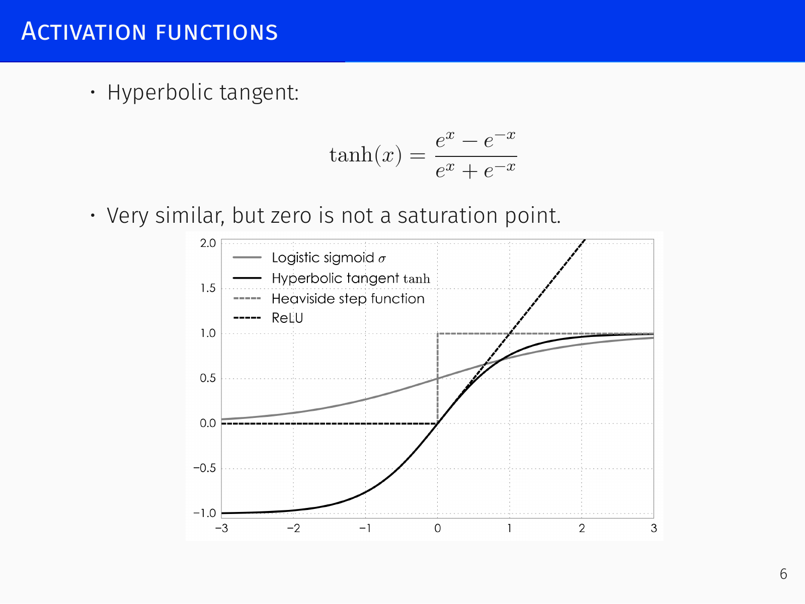
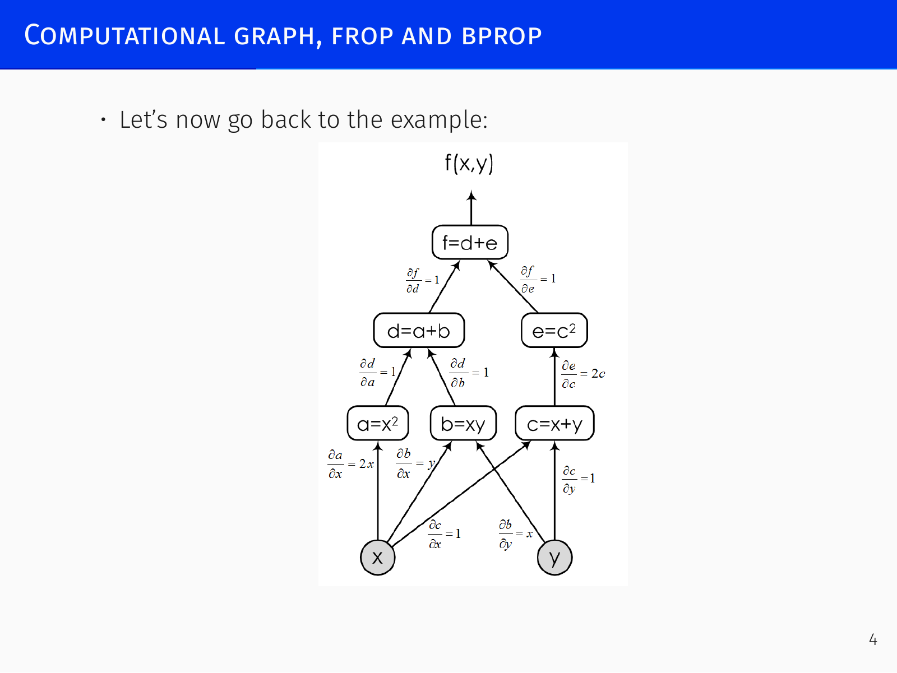
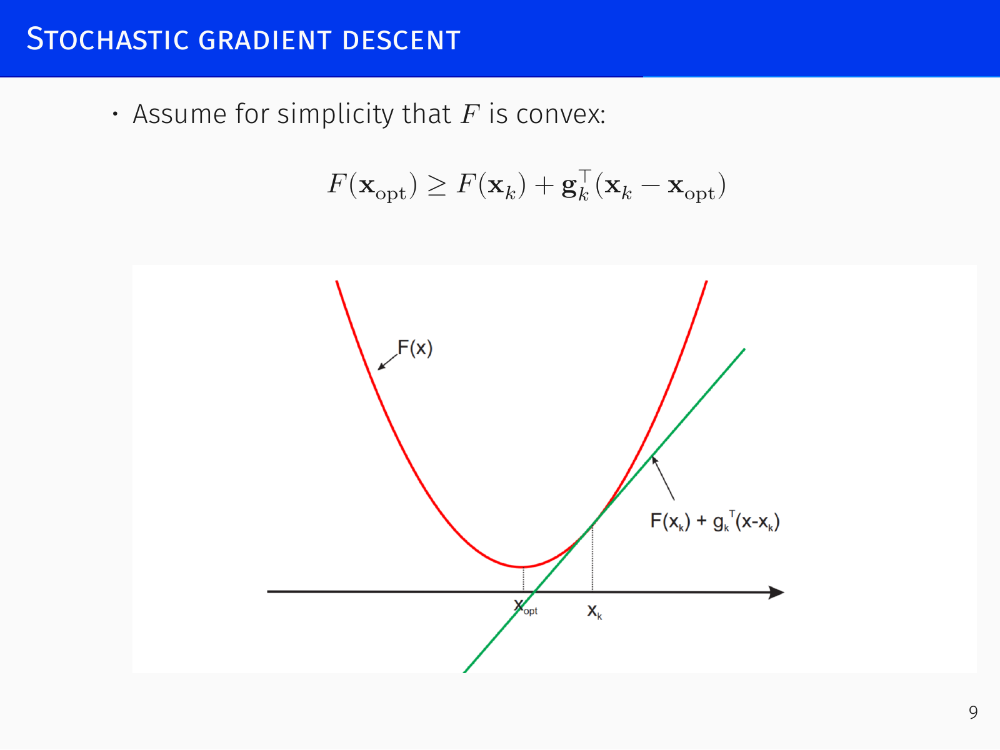
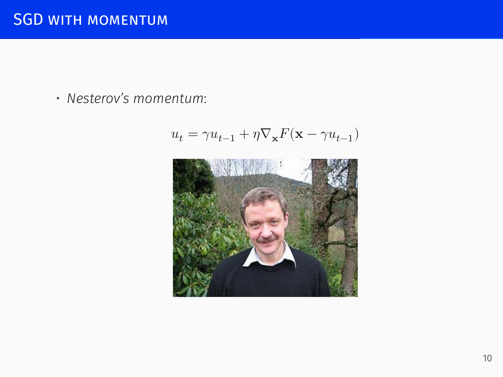
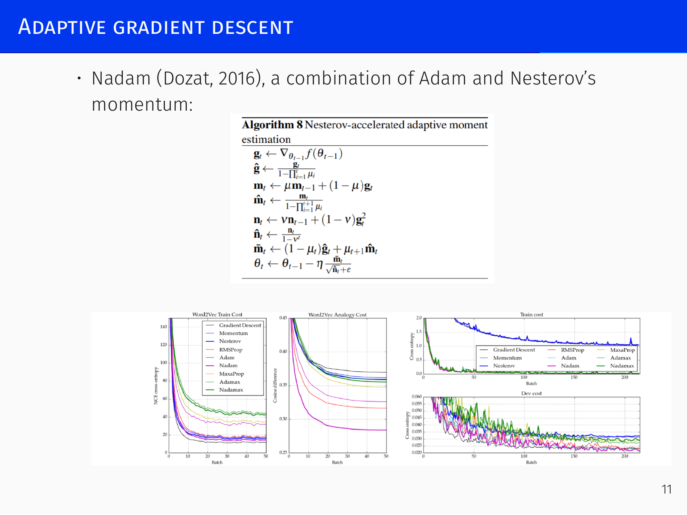
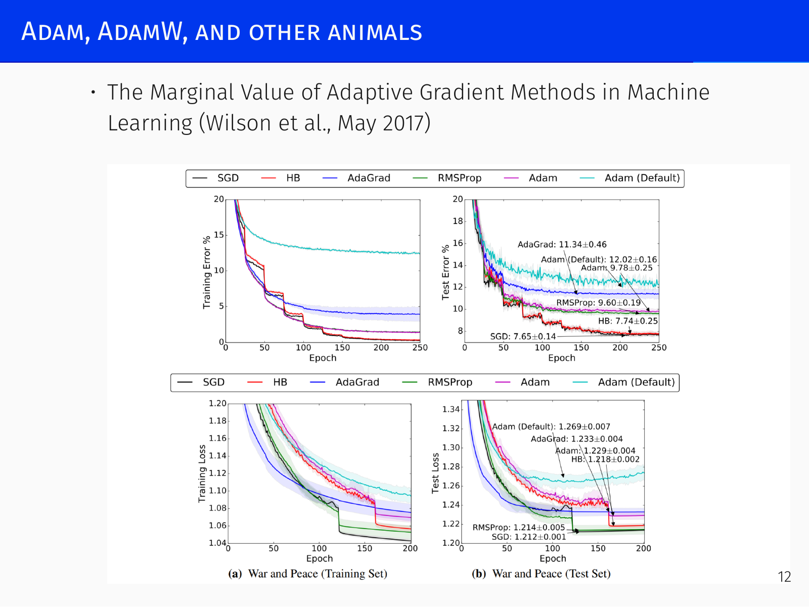

# Gradient Descent and General DL Remarks

## Activation Functions *[06:30]*

### The Need for Non‑linearity and Early Choices

A neural network is built from perceptrons that apply a non‑linearity to a linear combination of inputs. Without a non‑linearity, a composition of linear maps remains linear and the whole network collapses to a single perceptron.  
Early models (McCulloch–Pitts, Rosenblatt) used step (threshold) functions:

$$ \text{step}(x) = \begin{cases}
0, & x < 0, \\
1, & x > 0.
\end{cases} $$

Although universal approximation exists, gradient‑based training is impossible because the derivative is zero almost everywhere.  

To obtain a smooth, differentiable alternative, the field adopted **sigmoid** functions, which are monotonic with horizontal asymptotes on both sides:
- **Logistic sigmoid:** $\displaystyle \sigma(x) = \frac{1}{1+e^{-x}}$ (range $[0,1]$).
- **Hyperbolic tangent:** $\displaystyle \tanh(x) = \frac{e^x - e^{-x}}{e^x + e^{-x}}$ (range $[-1,1]$, symmetric around zero, preferred for internal layers because it avoids saturation near zero).

These served as the standard activations until about 2011–2012. Their main drawback is **saturation**: derivatives vanish on both tails, halting learning once a neuron is strongly activated.

### Rectified Linear Unit (ReLU)

> $$ \text{ReLU}(x) = \max(0, x) $$

Introduced around 2011–2012, ReLU is zero for $x<0$ and equal to $x$ for $x\ge0$. It does **not saturate on the positive side**, so gradients keep flowing for strongly active neurons; on the negative side it produces exact zeros, which can introduce sparsity — often acceptable in convolutional networks where weights are reused.  
A mathematical observation: a sum of shifted sigmoids approximates a soft ReLU:

$$ \sigma\!\left(x+\tfrac{1}{2}\right) + \sigma\!\left(x-\tfrac{1}{2}\right) + \sigma\!\left(x-\tfrac{3}{2}\right) + \dots $$

Biologically, a simple integrate‑and‑fire neuron with a refractory period yields a response curve that resembles ReLU.  
When a neuron’s input is negative, the gradient is strictly zero and no learning occurs on that sample.

### Leaky ReLU, ELU, and Beyond

To preserve gradient flow on the negative side, **Leaky ReLU** adds a small slope $a$:

$$ \text{LReLU}(x) = \begin{cases} a x, & x<0,\\ x, & x\ge0. \end{cases} $$

It is still a single‑hinge function but never kills gradients completely.

**Exponential Linear Unit (ELU)** smooths the negative part with an exponential:

$$ \text{ELU}(x) = \begin{cases} \alpha(e^x-1), & x<0,\\ x, & x\ge0. \end{cases} $$

ELU can produce negative outputs and a non‑zero mean, which sometimes speeds up learning.

### Automatically Discovered Activations: Swish and Mish

An evolutionary search over computational graphs of elementary operations produced the **Swish** activation (Ramachandran et al. 2017):

$$ \text{Swish}(x) = x\,\sigma(\beta x) = \frac{x}{1+e^{-\beta x}}. $$

Swish is non‑monotonic: on the negative side it first dips below zero and then returns to zero. Empirically it often outperforms ReLU.  

**Mish** (Misra 2019) is a related variation:

$$ \text{Mish}(x) = x \tanh\!\bigl(\text{softplus}(x)\bigr) = x \tanh\!\bigl(\ln(1+e^x)\bigr). $$

### Gaussian Linear Unit (GELU)

In present‑day large models (e.g., transformers, LLMs) the **Gaussian Linear Unit (GELU)** is common. It multiplies the input by the cumulative distribution function of a standard normal:

$$ \text{GELU}(x) = x\,\Phi(x) \approx 0.5x\bigl(1+\tanh\bigl(\sqrt{2/\pi}(x+0.044715x^3)\bigr)\bigr). $$

Its shape resembles Swish but often works slightly better in modern architectures. A practical trial order is ReLU, then Swish or GELU, and perhaps Leaky ReLU.

### ACON: A General Framework

A smooth generalisation of the maximum (Ma et al. 2020) unifies many activations. For two functions $g(x),h(x)$ and a smoothness parameter $\beta$,

$$
\begin{aligned}
S_\beta(g(x), h(x)) &= g(x)\frac{e^{\beta g(x)}}{e^{\beta g(x)}+e^{\beta h(x)}} + h(x)\frac{e^{\beta h(x)}}{e^{\beta g(x)}+e^{\beta h(x)}} \\
&= g(x)\sigma(\beta(g-h)) + h(x)\sigma(\beta(h-g)) \\
&= (g(x)-h(x))\,\sigma(\beta(g-h)) + h(x).
\end{aligned}
$$

Different choices yield known activations:
- **ACON‑A:** $g(x)=x,\; h(x)=0$ → **Swish** (soft); $\beta\to\infty$ recovers **ReLU**.
- **ACON‑B:** $g(x)=x,\; h(x)=a x$ ($a<1$) → soft LReLU; hard limit is ordinary Leaky ReLU.
- **ACON‑C:** $g(x)=a_1 x$, $h(x)=a_2 x$ with learnable $a_1,a_2$ that set the asymptotic slopes:

$$ \lim_{x\to\infty} \frac{d f_{\text{ACON-C}}}{dx} = a_1,\qquad \lim_{x\to-\infty} \frac{d f_{\text{ACON-C}}}{dx} = a_2. $$

Even on standard tasks, tuning these learnable parameters can give improvements, showing that the design space of activation functions is still far from exhausted.

---

## Computational Graphs and Backpropagation *[30:44]*

A neural network is a huge differentiable function that computes a loss $L(w)$ from inputs $x$, labels $y$, and weights $w$. To minimise $L(w)$ we need its gradient with respect to every weight — millions of parameters. The only practical way is to exploit that $L$ is a composition of simple operations.

### Computational Graph

We represent the function as a directed acyclic graph where each node is an elementary operation (addition, multiplication, activation, etc.) for which we know the local value and derivative.  
For an example $f(x,y) = (x+y)^2(x-y) + y^3$, the graph is:

- $a = x+y$
- $b = x-y$
- $c = y^3$
- $d = a^2$
- $e = d \cdot b$
- $f = e + c$

Given concrete numbers, **forward propagation** (inputs → output) computes the function value in one pass. At $x=2,\; y=-1$ we get $f=2$.

### Why Forward‑Mode Differentiation Does Not Scale

We can compute $\frac{df}{dx}$ during the same forward pass by carrying derivatives alongside values, obtaining e.g. $\frac{df}{dx}=7$. But if we need the full gradient with respect to every input (millions of weights), forward‑mode requires either:
- a separate graph traversal per variable ($10^6$ passes),
- or storing a vector of all partials at every node, exploding memory.

Real neural networks have **one scalar loss** and **millions of parameters**, making forward‑mode impractical.

### Backpropagation

Backprop reverses the computation: start from the output $f$ and propagate derivatives backward using the chain rule.

Induction base: $\frac{df}{df}=1$.  
For any node $g$ with children $g'$,

$$ \frac{\partial f}{\partial g} = \sum_{g' \in \text{Children}(g)} \frac{\partial f}{\partial g'} \frac{\partial g'}{\partial g}. $$

In the example:

- $\frac{df}{de}=1$, $\frac{df}{dc}=1$
- $\frac{df}{dd} = \frac{df}{de}\frac{de}{dd} = 1 \cdot b$
- $\frac{df}{da} = \frac{df}{dd}\frac{dd}{da} = b \cdot 2a$
- $\frac{df}{dx} = \frac{df}{da}\frac{da}{dx} + \frac{df}{db}\frac{db}{dx} = 2ab + d$

The values $a,b,d$ are available because they were stored during a **forward pass**. In a single **backward pass** we obtain all partial derivatives simultaneously.

> **Backpropagation = forward pass (store intermediate values) + backward pass (propagate derivatives).**

This two‑pass procedure is the core engine of every deep learning framework (PyTorch, TensorFlow, Theano). The rest of the framework — layer classes, optimisers — is syntactic sugar built around automatic differentiation.  
(Biological neurons cannot implement backprop because they would need separate output pathways for the value and the derivative.)

---

## Gradient Descent and Stochastic Gradient Descent *[35:36]*

The loss we minimise is the average over the training set:

$$ L(w) = \frac{1}{N}\sum_{n=1}^N \ell(x_n, y_n, w). $$

Full gradient descent computes the exact gradient $\nabla L(w)$ on every step, which is prohibitively expensive. Instead, we sample a **mini‑batch** of $m$ examples and use the stochastic estimate.

### Stochastic Gradient Descent (SGD)

$$ \mathbf{x}_{k+1} = \mathbf{x}_k - \alpha_k \,\hat{\mathbf{g}}_k, \qquad 
\hat{\mathbf{g}}_k = \frac{1}{m}\sum_{i=1}^m \nabla\ell(x_i, y_i, \mathbf{x}_k). $$

$\hat{\mathbf{g}}_k$ is an **unbiased** estimate of $\nabla F(\mathbf{x}_k)$, where $F(\mathbf{x}) = \mathbb{E}_{(\mathbf{x},y)} \ell(\mathbf{x},y,\mathbf{w})$ is the empirical risk. Mini‑batches are easy to parallelise and smooth out excessive stochasticity.

### Why Classical Optimisation Tools Fail

Deterministic gradient descent can use step‑size rules like the **Wolfe conditions** to select $\alpha$:
- **Armijo rule:** $f(\mathbf{x}_k + \alpha \mathbf{p}_k) \le f(\mathbf{x}_k) + c_1 \alpha \nabla f(\mathbf{x}_k)^\top \mathbf{p}_k$, $c_1\in(0,\tfrac12)$.
- **Strong Wolfe:** additionally $|\nabla f(\mathbf{x}_k + \alpha \mathbf{p}_k)^\top \mathbf{p}_k| \le c_2 |\nabla f(\mathbf{x}_k)^\top \mathbf{p}_k|$.

These require exact function and gradient evaluations — impossible with noisy SGD estimates.

**Newton’s method** takes the second‑order Taylor expansion, scaling the step by the inverse Hessian:

$$ \mathbf{x}_{k+1} = \mathbf{x}_k - \alpha_k H_k^{-1} \nabla F(\mathbf{x}_k). $$

It automatically adjusts the step per coordinate and eliminates hand‑tuning of the learning rate. For deep networks $H_k$ would be a million‑by‑million matrix — impossible to compute, store, or invert.

**Quasi‑Newton** methods such as **L‑BFGS** maintain a low‑rank approximation of $H^{-1}$ from stored gradients and updates, achieving second‑order‑like behaviour with modest memory. However, they critically depend on accurate gradients. Replacing exact gradients with noisy mini‑batch estimates breaks them. Making quasi‑Newton methods work with SGD remains an open problem.

### Convergence Analysis of SGD

Assuming convexity, bounded initial distance $\|\mathbf{x}_0 - \mathbf{x}_{\text{opt}}\| \le R$, and bounded variance $\mathbb{E}\|\hat{\mathbf{g}}_k\|^2 \le G^2$, one obtains for a weighted average $\hat{\mathbf{x}}_k$:

$$ \mathbb{E} F(\hat{\mathbf{x}}_k) - F(\mathbf{x}_{\text{opt}}) \le \frac{R^2 + G^2 \sum_{i=0}^k \alpha_i^2}{2\sum_{i=0}^k \alpha_i}. $$

**Key consequences:**
- **Constant step size $\alpha_i = h$:** the bound tends to $\frac{G^2 h}{2}$ — SGD converges to an uncertainty ball of radius proportional to $h$.
- To drive the error to zero, step sizes must satisfy $\sum_k \alpha_k = \infty$ and $\sum_k \alpha_k^2 < \infty$, e.g., $\alpha_k \propto 1/k$.
- The variance term introduces $O(1/\sqrt{k})$ convergence instead of the $O(1/k)$ of full GD, but each iteration is orders of magnitude cheaper.
- Mini‑batch sizes are often tiny (4–8), so the variance $G^2$ remains large. This noise is the root cause that kills line‑search and quasi‑Newton methods.

---

## SGD with Momentum *[2:20:33]*

A central problem is **ill‑conditioning**: different parameter dimensions have vastly different scales. In the quadratic $f(x,y) = x^2 + \rho y^2$ with $\rho \ll 1$, $y$ changes much slower than $x$, yet the maximum stable learning rate is limited by the steep $x$‑direction. Plain gradient descent either diverges on $x$ or crawls on $y$.

### Classical Momentum

To maintain velocity and damp oscillations, we keep a fraction $\gamma$ of the previous update:

$$
\mathbf{u}_t = \gamma \mathbf{u}_{t-1} + \eta \nabla F(\mathbf{x}_t), \qquad
\mathbf{x}_{t+1} = \mathbf{x}_t - \mathbf{u}_t.
$$

With $\gamma$ near $0.95$–$0.99$, the optimisation behaves like a rolling ball with friction: it keeps moving in directions where the gradient consistently points, stabilising orthogonal oscillations and accelerating along shallow ravines.

### Nesterov Accelerated Gradient

Nesterov’s method looks ahead to the point where momentum would carry the parameters:

$$
\mathbf{u}_t = \gamma \mathbf{u}_{t-1} + \eta \nabla F(\mathbf{x}_t - \gamma \mathbf{u}_{t-1}), \qquad
\mathbf{x}_{t+1} = \mathbf{x}_t - \mathbf{u}_t.
$$

Intuition: it anticipates the upcoming curve and starts slowing before the turn, like a good driver — rather than a passive ball that overshoots. Mathematically, it improves asymptotic convergence rates and damps oscillations more effectively.

---

## Adaptive Gradient Descent *[2:34:35]*

Even momentum does not solve the fundamental scaling problem: each coordinate may need a **different learning rate**. Adaptive methods maintain per‑parameter rates, increasing them for parameters with small, consistent gradients and decreasing them for those with large, rapidly changing gradients.

### AdaGrad

AdaGrad accumulates squared gradients in a diagonal matrix $G_t$:

$$ G_{t,ii} = G_{t-1,ii} + g_{t,i}^2, \qquad
w_{t+1,i} = w_{t,i} - \frac{\eta}{\sqrt{G_{t,ii} + \epsilon}}\, g_{t,i}. $$

On steep dimensions $G_{t,ii}$ grows quickly, shrinking the effective learning rate; on shallow slopes it grows slowly, allowing larger steps. The drawback is that $G_{t,ii}$ only grows, so the learning rate decays monotonically and never recovers.

### RMSprop

RMSprop replaces the cumulative sum with an **exponential moving average** (EMA) of squared gradients:

$$ G_{t,ii} = \rho G_{t-1,ii} + (1-\rho) g_{t,i}^2, \qquad
\mathbf{u}_t = -\frac{\eta}{\sqrt{G_{t,ii} + \epsilon}}\, g_{t,i}. $$

Old history is exponentially forgotten, so the learning rate can speed up again when the landscape flattens.

### AdaDelta and Unit Matching

A physical insight: gradient descent subtracts a velocity ($g$, units $[\text{loss}]/[\text{param}]$) from a parameter (units $[\text{param}]$), which is dimensionally inconsistent. Newton’s method fixes this because $H^{-1}\nabla f$ has units $[\text{param}]$.  
AdaDelta approximates the RMS of parameter updates with another EMA and uses it to normalise the step:

$$ \mathbb{E}[\Delta w^2]_t = \rho \mathbb{E}[\Delta w^2]_{t-1} + (1-\rho) \Delta w_t^2, \qquad
\mathbf{u}_t = - \frac{\sqrt{\mathbb{E}[\Delta w^2]_{t-1} + \epsilon}}{\sqrt{G_{t,ii} + \epsilon}}\, g_{t,i}. $$

The idea is elegant, though AdaDelta did not become widely used.

### Adam

Adam combines RMSprop’s adaptive scaling with momentum, smoothing both the gradient and its square:

$$
\begin{aligned}
m_{t,i} &= \beta_1 m_{t-1,i} + (1-\beta_1) g_{t,i}, \\
v_{t,i} &= \beta_2 v_{t-1,i} + (1-\beta_2) g_{t,i}^2, \\
\hat{m}_{t,i} &= \frac{m_{t,i}}{1-\beta_1^t},\quad
\hat{v}_{t,i} = \frac{v_{t,i}}{1-\beta_2^t}, \\
w_{t+1,i} &= w_{t,i} - \frac{\eta}{\sqrt{\hat{v}_{t,i}} + \epsilon}\,\hat{m}_{t,i}.
\end{aligned}
$$

The moving average $m_t$ reduces gradient variance across mini‑batches; $v_t$ adapts the learning rate per coordinate. Bias correction compensates for zero‑initialised EMAs. Recommended defaults ($\beta_1=0.9$, $\beta_2=0.999$, $\epsilon=10^{-8}$) work well without tuning, making Adam the de facto default in many projects.

**Nadam** further incorporates Nesterov momentum into Adam. A unified framework treats all these variants as diagonal rescaling of the gradient with optional momentum and momentum‑lookahead.

---

## AdamW, Regularisation, and Practical Remarks *[2:56:07]*

### Weight Decay vs. $L_2$ Regularisation

Classical **weight decay** multiplies weights by a factor $(1-w)$ before adding the gradient step:

$$ \mathbf{x}_{t+1} = (1-w)\mathbf{x}_t - \eta \nabla f_t(\mathbf{x}_t). $$

For plain SGD this is equivalent to minimising $\ell(\mathbf{x}) + \frac{w}{2\eta}\|\mathbf{x}\|^2$. With momentum or adaptive methods, the equivalence breaks — the regularisation term interacts with the adaptive scaling, coupling the hyperparameter $w$ to the learning rate.

**AdamW** decouples weight decay from the adaptive update:

$$ \mathbf{w}_t = \mathbf{w}_{t-1} - \eta\!\left( \frac{1}{\sqrt{\hat{\mathbf{v}}_t}+\epsilon}\hat{\mathbf{m}}_t + w\,\mathbf{w}_{t-1} \right). $$

This restores the original weight‑decay behaviour, simplifies hyperparameter tuning, and often improves generalisation compared to standard Adam with $L_2$.

### Generalisation and Adaptive Methods

Evidence shows that adaptive methods (Adam) can converge to minima that generalise worse than plain SGD (Wilson et al. 2017). Switching from Adam to SGD mid‑training has been proposed as a compromise. Nonetheless, properly tuned AdamW remains a strong, widely used choice.

### Super‑Convergence and Cyclical Schedules

A 2017 paper on **Super‑Convergence** showed that cyclic learning rate schedules (alternating fast and slow phases) can accelerate training 10–20× and yield models of comparable quality. The idea generated excitement but never became a universal standard; cyclical schedules are used in some contexts but are not a default.

### AMSGrad: Theory vs. Practice

The original convergence proof of Adam contained a mistake. **AMSGrad** (Reddi et al. 2018) corrected it by replacing the EMA of squared gradients with the maximum over past values, guaranteeing convergence. Despite winning the ICLR 2018 Best Paper Award, AMSGrad does not consistently outperform Adam in practice and is rarely used — a reminder that theoretical correctness alone does not displace empirically successful methods.

### Current Practice

Today, standard training algorithms are **Adam**, **AdamW**, and **plain SGD with momentum** (the latter still very effective when combined with careful learning-rate tuning). Newer algorithms like Lion and Muon have appeared, but the mainstays remain Adam‑family optimisers. For activations, **GELU** is prevalent in large language models, while ReLU and Swish are common in vision.
