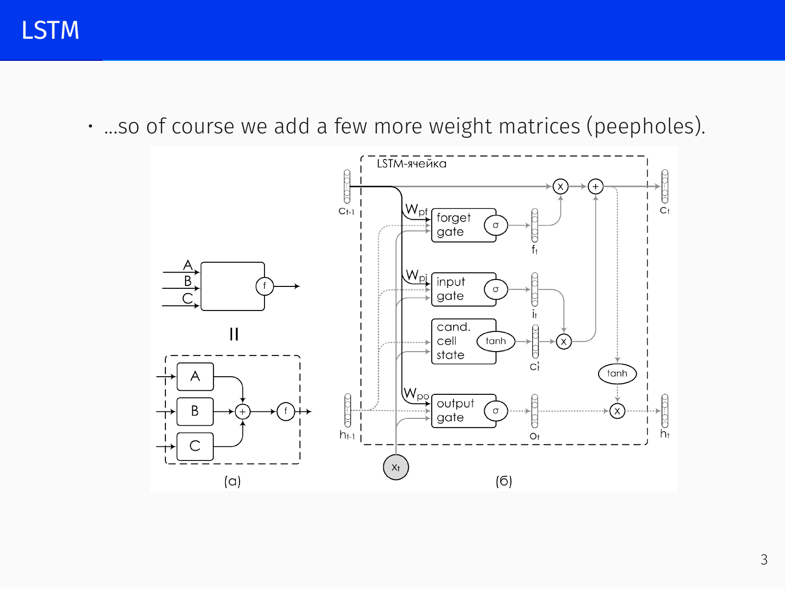
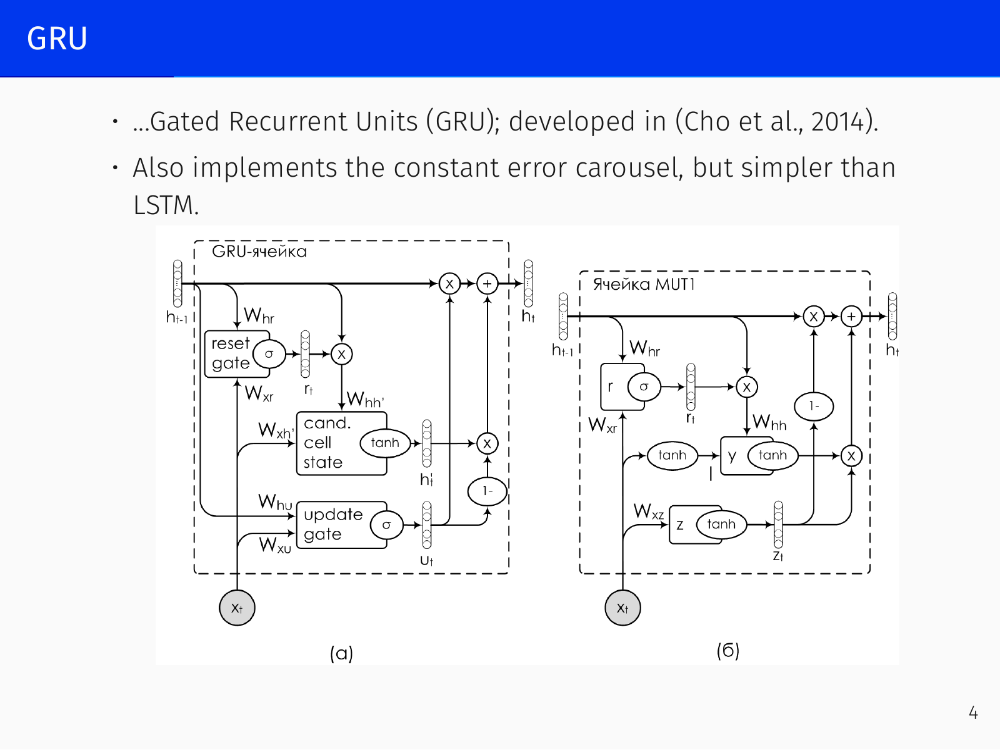
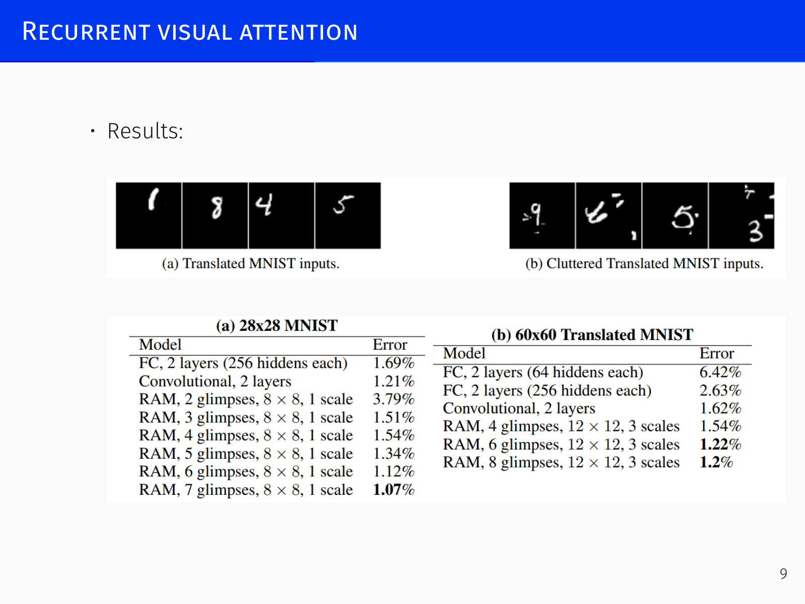
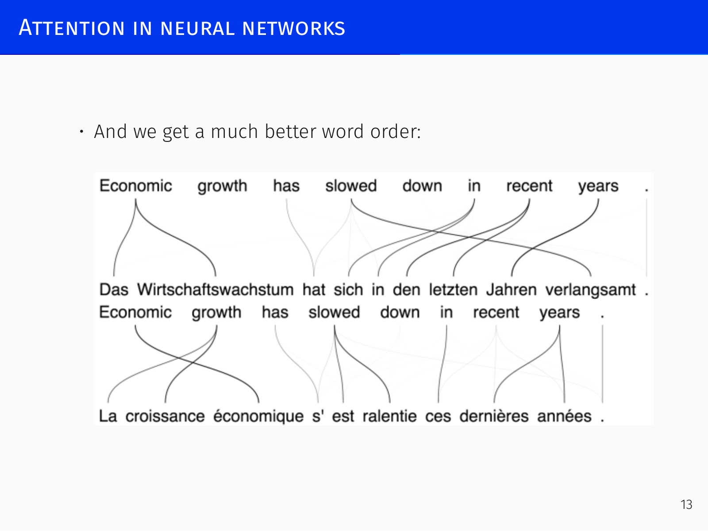
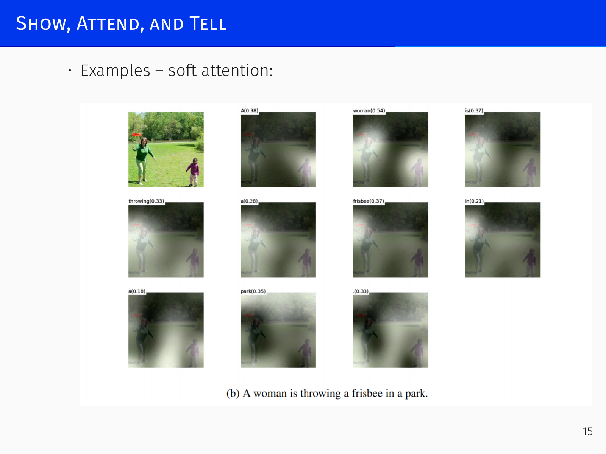
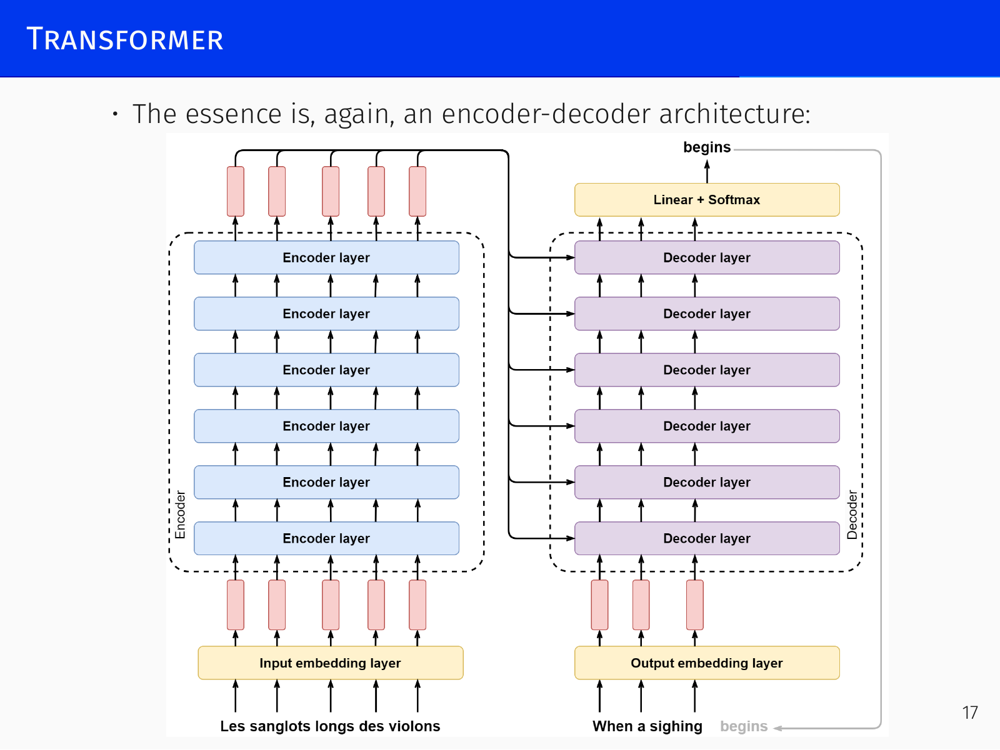

# Attention and Transformers

## Recurrent Networks and the Vanishing Gradient Problem *[00:49]*

Recurrent neural networks, like their deep feedforward counterparts, suffer from vanishing and exploding gradients. Because an RNN effectively forms a network that is as deep as the sequence length—the hidden state passes through the same weight matrix at every time step—parameter sharing amplifies the problem. When the spectral radius of the recurrent weight matrix \(W\) is less than \(1\), multiplying by \(W\) repeatedly drives gradients toward zero; when it exceeds \(1\), gradients explode. Exploding gradients produce numerical overflows that are immediately obvious, but vanishing gradients are far more dangerous: the loss w.r.t. \(W\) may still decrease because recent steps provide training signal, while the network becomes incapable of capturing long-term dependencies—the first input \(x_1\) can no longer influence the output at step \(t\). The network’s effective memory collapses to the last few elements of the sequence.

The solution mirrors the residual connections later adopted in ResNet: provide a gradient highway that bypasses repeated matrix multiplication. This idea originated with recurrent networks, which are essentially unusable without it. By allowing gradients to flow around the weight matrices, it becomes possible to retain information over arbitrarily many steps.

## Long Short-Term Memory (LSTM) *[09:18]*

### The LSTM Cell

The LSTM (Hochreiter & Schmidhuber 1995, 1997; Gers & Schmidhuber 2000) builds such a highway by explicitly splitting the hidden state into a **cell state** \(c_t\) (the long‑term memory that serves as a gradient carousel) and an ordinary **hidden state** \(h_t\). Three gates—forget, input, and output—regulate read, write, and forget operations on the cell state. Their outputs are obtained by passing a linear combination of \(h_{t-1}\) and \(x_t\) through a logistic sigmoid, which squashes values into \((0,1)\) and provides a smooth, differentiable approximation of a logic gate. A sigmoid output near \(0\) closes the gate; a value near \(1\) opens it completely.

The formal definition is:

\[
\begin{aligned}
c'_t &= \tanh(W_{xc} x_t + W_{hc} h_{t-1} + b_{c'}) \quad &\text{(candidate cell state)} \\[2pt]
i_t  &= \sigma(W_{xi} x_t + W_{hi} h_{t-1} + b_i) \quad &\text{(input gate)} \\[2pt]
f_t  &= \sigma(W_{xf} x_t + W_{hf} h_{t-1} + b_f) \quad &\text{(forget gate)} \\[2pt]
o_t  &= \sigma(W_{xo} x_t + W_{ho} h_{t-1} + b_o) \quad &\text{(output gate)} \\[2pt]
c_t  &= f_t \odot c_{t-1} + i_t \odot c'_t \quad &\text{(cell state)} \\[2pt]
h_t  &= o_t \odot \tanh(c_t) \quad &\text{(block output)}
\end{aligned}
\]

The cell behaves like a memory‑manipulation program: the forget gate erases information from \(c_{t-1}\) (multiplication by a number near zero erases, near one retains), the input gate writes new content from the candidate \(c'_t\) into the cleared locations, and the output gate reads a filtered version of the updated cell state into \(h_t\). The \(\tanh\) on the candidate output and the final \(\tanh\) before the output gate are not essential—many variations exist—but they are the conventional choices.

### Constant Error Carousel and Highway Gradients

The critical architectural benefit is that the cell state update contains a direct path for gradients. When the forget gate is fully open (\(f_t = 1\)), the update reduces to

\[
c_t = c_{t-1} + i_t \odot c'_t
\]

and consequently

\[
\frac{\partial c_t}{\partial c_{t-1}} = 1,
\]

so gradients can flow backward through the cell state unchanged. This **constant error carousel** prevents the vanishing gradient problem for long‑term dependencies, provided the gates do not close the route. Gradients are blocked only where the forget gate intentionally zeros a cell, which is desirable for forgetting.

### Peephole Connections and Variations

A weakness of the basic LSTM is that the gates only see \(h_{t-1} = o_{t-1} \odot \tanh(c_{t-1})\). If the output gate is closed, the cell state becomes invisible to the gating logic. **Peephole connections** (Gers & Schmidhuber) remedy this by giving each gate direct access to \(c_{t-1}\) through extra weight matrices:

\[
\begin{aligned}
i_t &= \sigma(W_{xi} x_t + W_{hi} h_{t-1} + W_{pi} c_{t-1} + b_i) \\
f_t &= \sigma(W_{xf} x_t + W_{hf} h_{t-1} + W_{pf} c_{t-1} + b_f) \\
o_t &= \sigma(W_{xo} x_t + W_{ho} h_{t-1} + W_{po} c_{t-1} + b_o)
\end{aligned}
\]

An enormous number of LSTM variants have been explored. Greff et al. (2015) (“LSTM: a Search Space Odyssey”) showed experimentally that some architectures with one fewer gate still perform nearly as well as the vanilla LSTM, but the classic design remains the most robust.

### Practical Considerations

The full LSTM cell involves eight weight matrices (for the combined \(h\) and \(x\) inputs to the three gates and the candidate), plus any peephole weights. If the cell dimension is \(d\) and the input dimension is \(d'\) (both commonly 64–1000), the parameter count is \(\mathcal{O}(d^2 + d\cdot d')\), which made large LSTMs difficult to train until around 2015. Nevertheless, large LSTMs have powered state‑of‑the‑art recurrent models ever since—AlphaStar, for example, used LSTMs for its StarCraft‑playing agent. Despite their age, no genuinely superior recurrent cell has displaced them, even after attempts at architecture search that produced cells with fewer parameters; those rarely generalise beyond their original benchmarks.

A classic toy demonstration of LSTM memory uses a stream where two channels of random numbers are marked by occasional ones, and the task is to sum the two numbers that were highlighted many steps apart. An LSTM learns to spike its cell state at the marker positions and hold the sum; a plain RNN with a linear cell cannot maintain such memory. On this simple problem GRUs may train faster, but the LSTM scales more reliably to harder tasks.

## Gated Recurrent Units (GRU) *[30:13]*

The GRU (Cho et al. 2014) achieves a similar constant error carousel with a simpler design. It merges the cell state and hidden state into a single vector \(h_t\) and uses only two gates—an update gate \(u_t\) and a reset gate \(r_t\)—eliminating the separate output gate:

\[
\begin{aligned}
u_t   &= \sigma(W_{xu} x_t + W_{hu} h_{t-1} + b_u) \quad &\text{(update gate)} \\
r_t   &= \sigma(W_{xr} x_t + W_{hr} h_{t-1} + b_r) \quad &\text{(reset gate)} \\[2pt]
h'_t  &= \tanh(W_{xh'} x_t + W_{hh'} (r_t \odot h_{t-1})) \quad &\text{(candidate state)} \\[2pt]
h_t   &= (1 - u_t) \odot h'_t + u_t \odot h_{t-1}
\end{aligned}
\]

The update gate performs a convex combination of the old state and the candidate: a high \(u_t\) retains \(h_{t-1}\); a low \(u_t\) accepts the new candidate. The reset gate controls which part of the previous memory influences the candidate. This reduction from eight (or eleven) weight matrices to six makes the GRU more parameter‑efficient. For a short period around 2015–2016 GRUs were widely adopted in NLP, but the field later returned to LSTMs—empirically they often perform better, though the reason is not fully understood.

## What is Attention? *[41:54]*

### Biological Attention and the Foveal Spotlight

Human vision does not process a whole scene uniformly. The fovea provides high resolution only in a tiny central patch; the rest of the visual field is low‑resolution. The eyes constantly move in rapid saccades, sampling different parts of the scene and integrating the glimpses into a coherent percept. Crucially, attention acts as a filter on working memory: everything enters the short‑term buffer, but only the items deemed important by an attentional mechanism are passed on for further processing. This is why an observer intensely focused on counting basketball passes can fail to see a person in a gorilla suit walk through the frame (Simons & Chabris 1999)—the gorilla is physically in the visual field, yet it never reaches conscious awareness.

### Early Glimpse‑Based Models

The observation that looking at only part of an image can be sufficient motivated early neural models that learned a sequence of **glimpses**. By blurring or down‑sampling the periphery and keeping a small high‑resolution patch, the input dimension shrinks dramatically, making computation more efficient. One of the first works (Larochelle & Hinton 2010) modelled saccade positions as a sequential decision process.

### Recurrent Models of Visual Attention

Mnih et al. (2014) fully realised this idea in “Recurrent Models of Visual Attention”. At each time step a recurrent network receives a glimpse \(g_t\) from the observation and the previous location, updates its hidden state \(h_t\), and outputs a new location \(l_t\) and action \(a_t\):

\[
\begin{aligned}
g_t &= f_g(x_t, l_{t-1}; \theta_g), \\
h_t &= f_h(h_{t-1}, g_t; \theta_h), \\
l_t &\sim p(\cdot \mid f_l(h_t; \theta_l)), \\
a_t &\sim p(\cdot \mid f_a(h_t; \theta_a)).
\end{aligned}
\]

A reward \(r_t\) is received after the action, and the objective is to maximise expected total reward \(J(\theta) = \mathbb{E}_{p(s_{1:T};\theta)}\!\left[\sum_{t} r_t\right]\). This defines a stochastic policy implemented by an RNN and trained with REINFORCE or other policy gradient methods. The model learns to move attention around the image, focusing on the object relevant for classification.

Later work extended the idea to deep generative models: DRAW (Gregor et al. 2015) uses recurrent attention in a variational autoencoder for image generation, and Ba et al. (2015) scaled it with variational approximations.

## Encoder-Decoder Architectures and Attention *[52:36]*

### The Bottleneck of a Single Vector

In machine translation, an encoder‑decoder RNN compresses the source sentence into a single fixed‑size vector, from which the decoder generates the translation. This works for short sentences, but performance degrades sharply as the input lengthens: a vector of fixed dimension cannot encode all the information of a long sentence, and increasing the vector size causes the decoder’s weight matrices to blow up quadratically. Moreover, the decoder has no way to focus on the particular source words that matter at each generation step.

### Soft Attention Mechanism

The solution (Bahdanau et al. 2014) is to have the decoder attend over *all* encoder hidden states, weighted by relevance. A small attention network takes the current decoder state \(z_{t-1}\) and each encoder position representation \(h_j\), and produces a score \(e_{tj}\):

\[
e_{tj} = a(z_{t-1}, j), \qquad
\alpha_{tj} = \operatorname{softmax}(e_{tj}), \qquad
c_t = \sum_j \alpha_{tj} h_j.
\]

The context vector \(c_t\)—a convex combination of the encoder vectors—is then fed to the decoder together with the previous token and state. The softmax converts the raw scores into a probability distribution that naturally sums to \(1\), so \(c_t\) has the same manageable size regardless of sequence length. The attention network accounts for only a tiny fraction (around 2 %) of the total parameters, yet it drives a dramatic improvement in translation quality, especially for long sentences.

### Learned Alignment and Interpretability

No ground‑truth alignment is provided during training; the attention network learns to align purely from the task signal (maximising translation likelihood). This is a general principle: if you structurally equip a network with a component that *could* perform a desired function, it often learns to do so correctly without explicit supervision.

The attention weights \(\alpha_{tj}\) are highly interpretable. In French‑to‑English translation they form a mostly diagonal matrix, but with revealing exceptions: “la destruction” → “destruction” shows high weight on both input words while producing one output token; “armes chimiques” → “chemical weapons” yields off‑diagonal attention reflecting the word‑order swap. In a sequence reversal task the attention matrix becomes a reverse diagonal, letting the model reverse without memorising the whole sequence; in a sorting task the decoder attends to the position of the current minimum at each step, literally “picking” the correct element.

These properties extend beyond translation: treating a grammar parse tree as a flat string lets the same architecture handle structured outputs (Vinyals et al. 2015, “Grammar as a Foreign Language”).

### Google’s Neural Machine Translation System

Wu et al. (2016) scaled the architecture to very deep stacks (8 encoder + 8 decoder LSTM layers) with residual connections, making it the backbone of Google Translate for several years. The practical impact was swift and noticeable: by 2015–2016, machine translation, which previously produced nearly unusable output, reached a quality where post‑editing became faster than translating from scratch—a genuine phase transition.

## Show, Attend, and Tell: Attention for Image Captioning *[1:24:08]*

The encoder‑decoder pattern is not restricted to text. Image captioning illustrates how attention can operate over spatial features. Instead of compressing the whole image into a single feature vector, we stop the CNN slightly early, obtaining a grid of feature vectors \(\{\mathbf{a}_i\}_{i=1}^{L}\) (e.g. a \(14\times14\) map). At each decoding step, an attention mechanism computes weights \(\alpha_{t,i}\) over these vectors, forming a context \(\mathbf{c}_t = \sum_i \alpha_{t,i} \mathbf{a}_i\) that is fed to the LSTM language model.

Two variants were studied by Xu et al. (2015):

- **Soft attention**: a deterministic, differentiable weighted sum trained end‑to‑end.
- **Hard attention**: stochastic, where the attention location is sampled from \(\alpha_{t}\). Training maximises a variational lower bound:
  \[
  L_s = \sum_s p(s \mid a) \log p(y \mid s, a) \;\leq\; \log \sum_s p(s \mid a) p(y \mid s, a) = \log p(y \mid a),
  \]
  with gradients approximated by sampling \(s\) from the attention distribution.

The resulting attention maps are perfectly interpretable: when generating “woman” the model looks at people, “throwing” at the action, “frisbee” at the object, and “park” at the background.

## The Transformer *[1:27:53]*

### Overview and Scalability

The Transformer (Vaswani et al. 2017) discards recurrence entirely and relies solely on attention. Its original results showed a more efficient way of achieving comparable translation quality, but the architecture proved far more consequential. Two properties make it revolutionary:

1. **Generality**: it treats all data as sequences of vectors, and excels at capturing internal correlations in text, images, and beyond without modality‑specific design.
2. **Scalability**: unlike LSTMs, which saturate or become too expensive when scaled, transformers keep improving as the model size grows—from millions to trillions of parameters—without any fundamental architectural change. This never‑saturating behaviour was unprecedented.

The architecture follows the encoder‑decoder pattern. An encoder stack (six identical layers) transforms the source into a sequence of context‑rich representations; a decoder stack (six identical layers) generates the target token by token.

### Self-Attention Mechanism

Self‑attention draws on the information retrieval analogy. Each input vector \(x_i\) is projected into a **query** \(q_i = W_Q x_i\), a **key** \(k_i = W_K x_i\), and a **value** \(v_i = W_V x_i\). The query and key live in the same latent space, so their similarity is measured by dot product. For a given query \(q_i\), attention scores with all keys are scaled and fed through a softmax to yield convex weights, which are then used to combine the values:

\[
\operatorname{Attention}(Q, K, V) = \operatorname{softmax}\!\left( \frac{Q K^{\top}}{\sqrt{d}} \right) V .
\]

The scaling factor \(1/\sqrt{d}\) (where \(d\) is the key/query dimension) is essential: without it, the dot products grow with \(d\), the softmax saturates into a near‑one‑hot vector, and gradients vanish. By keeping the typical pre‑softmax value around \(1\), the scaling preserves entropy in the attention distribution and allows meaningful learning.

Crucially, every query attends to every key, including its own. This means any token can directly interact with any other token in a single step—information flows across the whole sequence in one layer, completely eliminating the step‑by‑step propagation that limits recurrent nets. The price is a quadratic \(\mathcal{O}(L^2)\) cost in sequence length \(L\). This quadratic bottleneck is the main algorithmic challenge for transformers, and it has motivated extensive research on sparse attention and long‑context techniques; scaling the naive quadratic computation to the million‑token windows advertised in modern models requires sophisticated engineering.

### Multi-Head Attention

A single attention head captures only one type of relationship. Multi‑head attention runs \(H\) independent attention operations in parallel, each with its own projection matrices \(W_Q^{(h)}, W_K^{(h)}, W_V^{(h)}\). The outputs \(Z^{(1)}, \dots, Z^{(H)}\) (each of shape \(L \times d\)) are concatenated into an \(L \times (Hd)\) matrix and projected back to the model dimension \(D\) by a learned weight matrix \(W_O\):

\[
Z = (Z_{\text{concat}} W_O)^{\top}, \qquad W_O \in \mathbb{R}^{Hd \times D}.
\]

Using multiple heads increases expressive power: each head can learn different projections of the input and capture distinct syntactic or semantic patterns. The per‑head dimension \(d\) is usually a fraction of the model dimension (e.g. \(d = D/H\)), keeping the total parameter count manageable while still producing rich representations.

### Decoder: Masked Attention and Encoder‑Decoder Attention

The decoder generates tokens autoregressively, so it must not peek at future positions. During training, the entire target sequence is available; rather than running the decoder step by step, masked self‑attention feeds the whole prefix at once but sets the attention weights for positions \(\ge t\) to \(-\infty\) before softmax. This causal mask forces the prediction at position \(t\) to depend only on positions \(1\dots t-1\), yielding the same gradient signal as sequential decoding but with massive parallelism.

**Encoder‑decoder attention** uses the same scaled dot‑product mechanism, but the queries come from the decoder’s previous layer (the current generation state), while the keys and values come from the encoder’s final output. This allows every decoder position to retrieve information from the entire encoded source. The sequences need not be the same length—the attention matrix is not forced to be square. The only requirement is that the number of keys equals the number of values; queries can come from an entirely different set, a design pattern that later models exploit heavily (e.g. in object detection, where queries are learned embeddings and keys/values come from image features).

### Tokenization: Byte‑Pair Encoding

Transformers operate on subword tokens produced by **Byte‑Pair Encoding (BPE)**. Words are too coarse (vocabulary explodes), individual characters are too fine (sequences become excessively long). BPE strikes a balance:

1. Start with every character as a separate token, and count all adjacent pairs in the training corpus.
2. Merge the most frequent pair into a new token, replace all its occurrences, and update the counts.
3. Repeat until the desired vocabulary size is reached.

Frequent subword units (e.g. “-ed”, “-tion”) coalesce into single tokens, common words become single tokens, and rare words remain split into several tokens. The algorithm is deterministic and easy to control—simply stop when the vocabulary budget is exhausted.

### Positional Encoding

Self‑attention has no inherent notion of token order. To inject sequence information, the original Transformer adds sinusoidal positional encodings to the input embeddings:

\[
\begin{aligned}
PE_{(pos, 2i)}   &= \sin\!\left(\frac{pos}{10000^{2i/d}}\right), \\
PE_{(pos, 2i+1)} &= \cos\!\left(\frac{pos}{10000^{2i/d}}\right).
\end{aligned}
\]

These encode each position with a set of sine/cosine waves of varying frequencies, analogous to a soft binary counting system. The encoding ensures that the dot product between two positions depends only on their relative offset, allowing the model to extrapolate to longer sequences than seen during training.

Modern transformers overwhelmingly use **rotary positional encodings (RoPE)**, which multiply each consecutive pair of embedding dimensions by a rotation matrix of angle \(k\theta\), where \(k\) is the position. Rotations compose additively, giving the same desirable arithmetic property while integrating more naturally with the attention computation.

### Results

The Transformer trains up to 100× faster than comparable recurrent models because all tokens are processed in parallel. Its self‑attention layers cut the path length between any two positions to a single step, capturing long‑range dependencies with ease. Attention weights offer a window into the model’s internal reasoning: after training, individual heads often specialise in interpretable operations—some behave like permutation matrices copying a specific token, others perform uniform averaging over syntactic groups. This combination of speed, quality, scalability, and interpretability has made the Transformer the foundation of virtually all modern deep learning systems.
