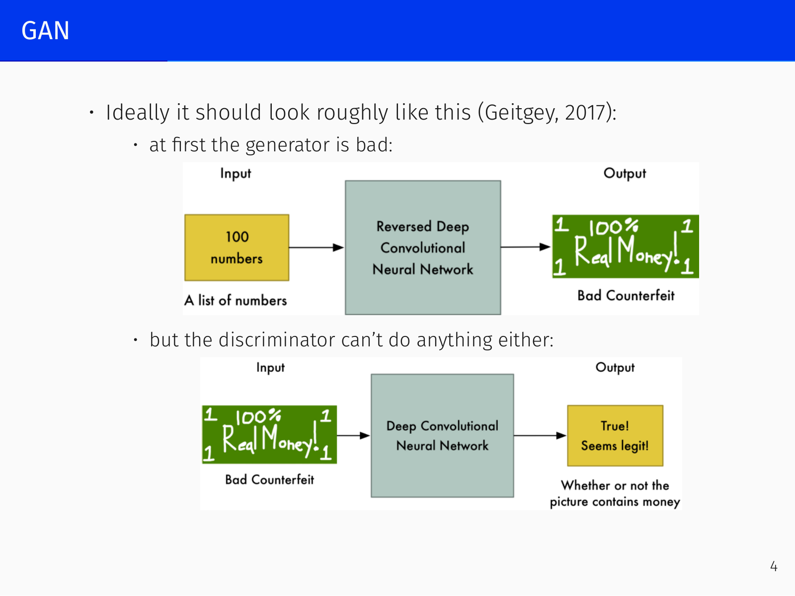
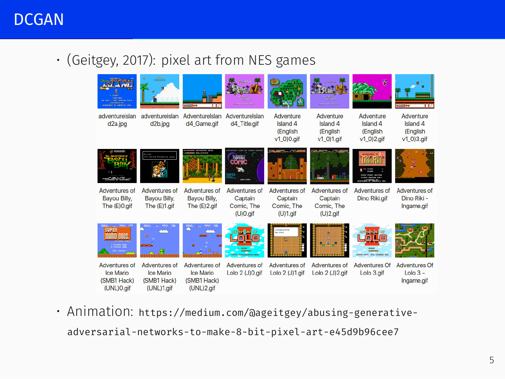
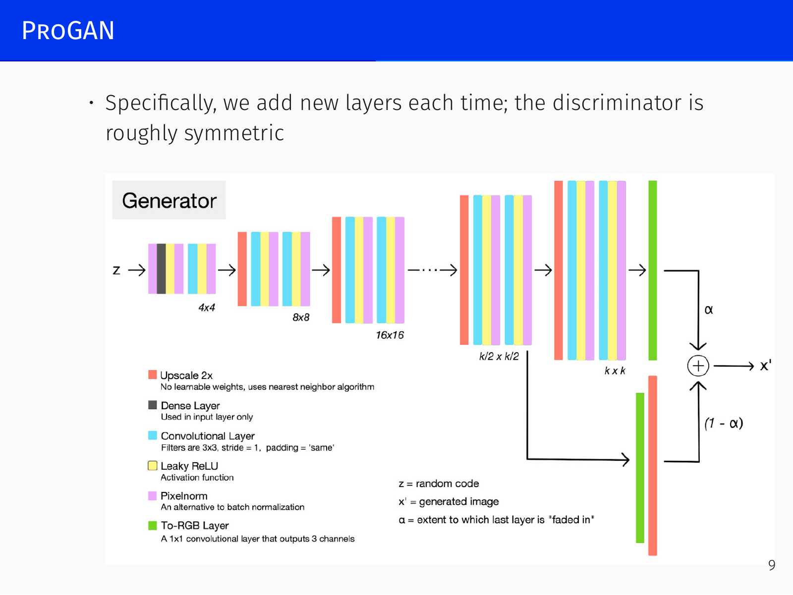
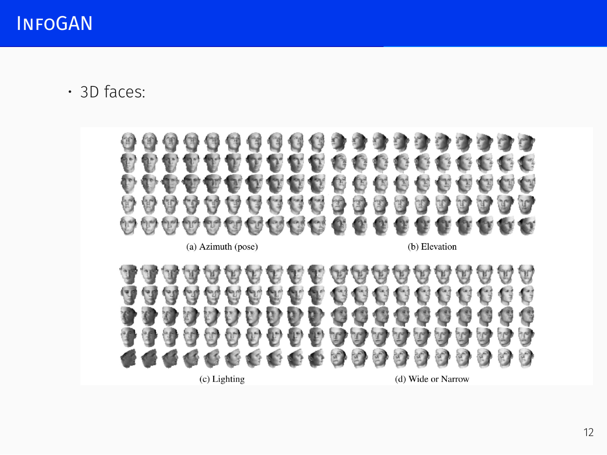
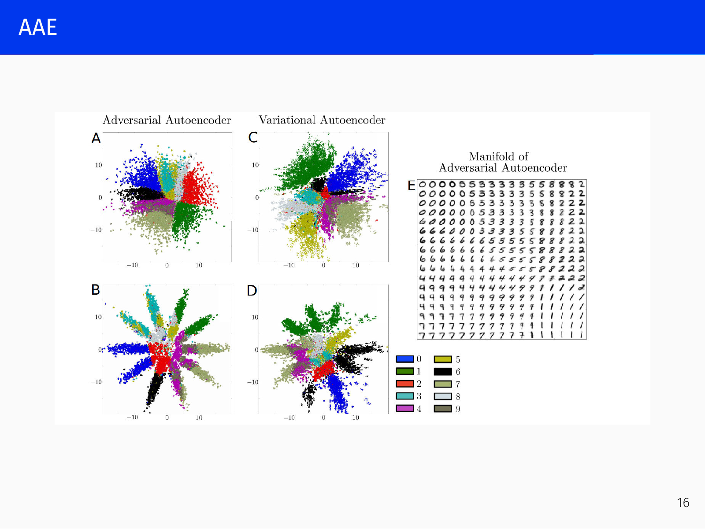

# Generative Adversarial Networks

## Deep Generative Models: A Taxonomy *[00:46]*

The term “generative AI” is broad—even logistic regression defines a probability distribution over classes—but here we concentrate on models that produce high‑dimensional, structured objects (images, text, music). Among neural‑network‑based deep generative models, the primary fork is between **explicit density models** and **implicit density models**.

Explicit density models provide (or approximate) a formula for $p(x)$, the probability of observing a data point $x$. They split into:

- **Tractable density** – the density $p(x)$ can be written down directly.  
  - **Autoregressive models** use the chain rule $p(x)=p(x_1)p(x_2|x_1)\dots p(x_n|x_1,\dots,x_{n-1})$ and parametrise the conditionals, e.g., with an RNN or Transformer. Most large language models are autoregressive. For images, PixelCNN generated pixels sequentially but was too slow for high resolution.  
  - **Flow‑based models** compose many simple invertible transformations: $x = f_k \circ \dots \circ f_1(z)$, so that a simple $z$ distribution is transformed into a complex one.

- **Approximate density** – $p(x)$ is approximated by a simpler distribution $q$. The main example is the **Variational Autoencoder (VAE)**, which uses a variational bound to derive a tractable loss. Diffusion models (next lecture) often operate in a VAE’s latent space.

**Implicit density models** do not supply a formula for $p(x)$; they are pure samplers. The most prominent member is the **Generative Adversarial Network (GAN)**. A noise vector $Z$ sampled from a simple distribution (e.g., a standard Gaussian) is mapped through a neural network to produce a sample $\hat{X}$ that should be indistinguishable from real data. The distribution of $\hat{X}$ is implicit—there is no access to its density.

The central challenge of generative modelling is defining the loss function: “what makes a good cat picture?”. There is no closed‑form answer. GANs address this by **learning the loss** itself.

---

## Introduction to GANs *[14:41]*

### The Adversarial Idea

A GAN consists of two networks playing a **minimax game**:

- **Generator** $G = G(z;\theta_g): Z \to X$ takes random noise $z \sim p_z$ and produces a sample $\hat{x} = G(z)$.
- **Discriminator** $D = D(x;\theta_d): X \to [0,1]$ is a binary classifier that outputs the probability that $x$ is real (1) rather than generated (0).

The discriminator sees real samples $x \sim p_{\text{data}}$ and fake samples $\hat{x} \sim p_g$ (the distribution induced by $G$). It is trained to maximise the probability of assigning the correct label. The generator is trained to **fool** the discriminator, i.e., to make $D(G(z))$ large.

Early in training the generator is poor and the discriminator untrained. One alternates: improve $D$ slightly, then improve $G$ to catch up, repeating until ideally $p_g = p_{\text{data}}$ and the discriminator cannot do better than random guessing. In practice this ideal is seldom reached, but the intuition drives the design.

### Formal Definition *[26:34]*

The discriminator solves a binary classification problem:

$$\mathbb{E}_{x \sim p_\text{data}(x)}[\log D(x)] + \mathbb{E}_{x \sim p_g(x)}[\log(1 - D(x))],$$

with $p_g(x) = G_{\#}p_z$, the pushforward of the noise distribution. Real samples get labels 1, generated samples labels 0.

The generator originally minimised

$$\mathbb{E}_{z \sim p_z(z)}[\log(1 - D(G(z)))],$$

which together with the discriminator’s objective gives the **minimax game**

$$\min_G \max_D V(D,G), \qquad
V(D,G) = \mathbb{E}_{x \sim p_\text{data}(x)}[\log D(x)] + \mathbb{E}_{z \sim p_z(z)}[\log(1 - D(G(z)))].$$

### Theoretical Optimality

For a fixed $G$ the optimal discriminator is the Bayes classifier:

$$D^*_G(x) = \frac{p_\text{data}(x)}{p_\text{data}(x) + p_g(x)}.$$

(Exercise: try to prove this.)  
Substituting $D^*_G$ into the generator’s objective shows that the global minimum is attained **iff** $p_g = p_\text{data}$. At the optimum the criterion equals the **Jensen–Shannon divergence**:

$$\operatorname{JS}(p_\text{data} \| p_g) =
\frac12\operatorname{KL}\!\left(p_\text{data} \bigg\| \frac{p_\text{data}+p_g}{2}\right) +
\frac12\operatorname{KL}\!\left(p_g \bigg\| \frac{p_\text{data}+p_g}{2}\right).$$

While these results are elegant, they are largely irrelevant in practice because the generator never uses the original loss. The reason is the **saturating gradient problem**.

### Practical Generator Loss *[34:42]*

Minimising $\mathbb{E}_{z}[\log(1 - D(G(z)))]$ uses a sigmoid at the discriminator’s output. When the discriminator is confident and correct—as it quickly becomes after a few training steps—its gradient saturates: $D(G(z)) \approx 0$, so $\log(1 - D(G(z))) \approx 0$ and the generator receives a vanishing learning signal. The generator can no longer improve.

**Solution:** flip the loss. Instead of minimising the probability of the discriminator being right, **maximise** the probability of it being wrong:

$$\text{Generator loss: } -\mathbb{E}_{z \sim p_z(z)}[\log D(G(z))].$$

Now when the discriminator is confident ($D(G(z)) \approx 0$) the loss is large and gradients flow; as the generator improves, the gradients diminish naturally. This is the loss used in all practical GAN training.

### Training Algorithm

Training alternates between two steps, akin to EM:

1. **Fix $G$** – update $D$ with  
   $$\mathbb{E}_{x \sim p_\text{data}(x)}[\log D(x)] + \mathbb{E}_{x \sim p_g(x)}[\log(1 - D(x))].$$
2. **Fix $D$** – update $G$ with  
   $$-\mathbb{E}_{z \sim p_z(z)}[\log D(G(z))].$$

*(Goodfellow et al., 2014: early GANs generated new samples, not memorizations; they worked well on MNIST but poorly on more diverse images.)*

---

## DCGAN – Deep Convolutional GAN *[41:33]*

The original GANs produced only tiny, low‑quality images. **DCGAN** (Radford et al., 2016) introduced key architectural stabilisers:

- Strided convolutions instead of pooling layers.
- Batch normalisation in both generator and discriminator.
- Removal of fully connected layers.
- Use of the Adam optimiser.

On LSUN bedrooms (64×64), after one epoch only coarse room structures appear, but after five epochs the images become much sharper and more realistic.

### Probing the Latent Space *[42:46]*

A discriminator that merely fails to tell real from fake does not guarantee that the generator understands the data manifold—the discriminator might be undertrained. A more convincing test is a **linear walk** in latent space. Take two latent vectors $z_1, z_2$ and interpolate between them: $z(\alpha) = (1-\alpha)z_1 + \alpha z_2$. If the generator has learned a smooth manifold, every interpolated $z$ should decode to a plausible image. If it simply memorised a few training points, interpolated images will be nonsensical blurs. This walk, often displayed in papers with the two endpoints as real images and the intermediate frames generated, shows that the latent space captures meaningful structure.

Additional explorations in DCGAN:

- Removing filters that detect windows removes windows from generated images.
- Vector arithmetic in latent space: “man with glasses” – “man” + “woman” yields “woman with glasses”.
- Application to pixel art from NES games.

Limitations remain: the model struggles with counting objects (e.g., too many eyes, limbs) and with perspective, because convolutional generators assemble local features with limited global context.

---

## Progressive Growing GAN (ProGAN) *[54:56]*

A major breakthrough came from NVIDIA (Karras et al., 2017) with **ProGAN**. The key idea is to avoid generating a full‑resolution image from scratch. Instead, train a GAN to produce small images (e.g., 4×4) and then stack super‑resolution steps, each doubling the resolution, up to 1024×1024. Because each stage works on a relatively easy sub‑problem, the whole training is more stable and faster—more data can be shown in the same wall‑clock time.

- New layers are added progressively; the discriminator remains roughly symmetric.
- For some categories resolution is stopped at 256×256, which already looks excellent.
- Training took about two weeks on large NVIDIA hardware at the time, yielding the famous photorealistic faces seen on websites like *This Person Does Not Exist*.

The authors compared **Least Squares GAN** and **Wasserstein GAN** losses, motivating the deeper study of loss functions.

---

## Loss Functions in GANs *[58:28]*

### Least Squares GAN (LSGAN) *[58:28]*

The original GAN loss suffered from vanishing gradients when the discriminator became too confident. LSGAN (Mao et al., 2016) addresses this by replacing the sigmoid cross‑entropy with a **quadratic loss**:

- Discriminator:  
  $$\min_D \frac12 \mathbb{E}_{x \sim p_\text{data}}[(D(x) - b)^2] + \frac12 \mathbb{E}_{z \sim p_z}[(D(G(z)) - a)^2]$$
- Generator:  
  $$\min_G \frac12 \mathbb{E}_{z \sim p_z}[(D(G(z)) - c)^2]$$

The discriminator learns to output $a$ for fakes and $b$ for reals; the generator wants the discriminator to output $c$ on fakes. Typically $a=0$, $b=c=1$. Because overshooting the target is also penalised, the loss avoids saturation and provides smooth gradients even when the discriminator is very accurate. LSGAN is more robust to architectural choices and suffers less from mode collapse.

### InfoGAN

*(Chen et al., 2016)* In a standard GAN the input is a monolithic noise vector $z$. **InfoGAN** splits it into two parts:
- $z$ – incompressible noise (the source of randomness);
- $c = c_1 c_2 \dots c_L$ – a **latent code** whose dimensions should correspond to interpretable factors of variation.

The generator becomes $G(z,c)$. Without extra pressure, $G$ could ignore $c$. InfoGAN therefore maximises the mutual information $I(c, G(z,c))$, using a variational lower bound parameterised by a neural network $Q$ (often sharing most of $D$).

Example on MNIST with $c = (c_1, c_2, c_3)$:
- $c_1$ – discrete 10‑way code (uniform prior) that learns digits **without supervised labels**;
- $c_2, c_3 \sim U[-1,1]$ control continuous properties (slant, thickness, etc.).

A classifier trained only on $c_1$ achieves 5% error on MNIST with zero labels. The approach also works on 3D faces and chairs.

### Wasserstein GAN (WGAN) *[1:00:19]*

The **Wasserstein GAN** (Arjovsky et al., 2017) tackles a deeper theoretical issue: why the usual KL divergence (and Jensen–Shannon divergence) often fails in high‑dimensional generative modelling.

> **The problem with KL divergence in high dimensions.**  
> In image generation, both the true data distribution $p_{\text{data}}$ and the model distribution $p_g$ are concentrated on low‑dimensional manifolds inside the million‑dimensional pixel space. Their supports are almost disjoint. Where $p_{\text{data}}(x) > 0$, $p_g(x) \approx 0$, and *vice versa*. The KL divergence then becomes infinite and provides **no useful gradient**—small changes to the generator keep the divergence infinite, so it cannot guide learning.
>
> In classical problems (e.g., linear regression) we avoid this by adding Gaussian noise to the model: $p_g$ is spread over the full space, making KL divergence well‑defined. But for image generation, adding noise makes the output blurry and unrealistic; we want crisp samples without artificial noise.

The **Earth Mover (Wasserstein‑1) distance** is designed precisely for this situation. Think of each distribution as a pile of earth: the Wasserstein distance is the minimal physical work (mass × distance) needed to transform one pile into the other. It varies smoothly even when the supports do not overlap.

$$W(p_{\text{data}}, p_{\text{model}}) = \inf_{\gamma \in \Pi(p_{\text{data}}, p_{\text{model}})} \mathbb{E}_{(x,y)\sim \gamma}\big[\|x - y\|\big],$$

where $\Pi$ is the set of joint distributions with the given marginals.

**Example:** take $Z \sim U[0,1]$, $\mathbb{P}_0$ the distribution of $(0,Z)$ in $\mathbb{R}^2$, and $g_\theta(z) = (\theta, z)$. As $\theta \to 0$, only the EM distance converges continuously; other distances (Jensen–Shannon, KL) behave pathologically.

The **Kantorovich–Rubinstein dual** gives a computable form:

$$W(p_{\text{data}}, p_{\text{model}}) = \sup_{\|f\|_L \le 1} \Big( \mathbb{E}_{x \sim p_{\text{data}}}[f(x)] - \mathbb{E}_{x \sim p_{\text{model}}}[f(x)] \Big),$$

where the supremum is over **1‑Lipschitz** functions. This leads to the WGAN training scheme:

- Replace the discriminator with a **critic** $f_w$ (output is not a probability, just a real number).
- For fixed generator $g_\theta$, train $f_w$ to maximise $\mathbb{E}_{x\sim p_{\text{data}}}[f(x)] - \mathbb{E}_{z\sim p_z}[f(g_\theta(z))]$.
- The generator gradient becomes  
  $$\nabla_\theta W = -\mathbb{E}_{z \sim p_z}\!\big[\nabla_\theta f_w(g_\theta(z))\big].$$

To enforce the 1‑Lipschitz constraint, one can use **weight clipping**: clamp the weights of $f_w$ to a small interval after each update.

Key practical advantages:
- The critic can be trained to convergence, unlike the discriminator in an ordinary GAN.
- The loss value strongly **correlates** with sample quality—it serves as a reliable metric.
- WGAN is far more robust to architectural choices; it continues to work even without batch normalisation or with fewer filters.

**Improved WGAN (WGAN‑GP)** (Gulrajani et al., 2017) replaces weight clipping (which can cause exploding/vanishing gradients and limit the critic’s capacity) with a **gradient penalty**:

$$\lambda \,\mathbb{E}_{\hat{x} \sim \mathbb{P}_{\hat{x}}}\!\big[(\|\nabla_{\hat{x}} D(\hat{x})\|_2 - 1)^2\big],$$

where $\hat{x}$ is sampled uniformly along straight lines between real and generated examples. This softer regularisation is now standard.

---

## Self‑Attention GAN (SAGAN) and BigGAN *[1:31:23]*

Convolutional generators have a strictly local receptive field, making it hard to capture long‑range dependencies (e.g., ensuring a dog has exactly one tail, in the right place). **Self‑Attention GAN** (Zhang et al., 2019) adapts the self‑attention mechanism from Transformers to images: the generator can attend to distant regions while drawing. Visualisations of the attention maps confirm that it “looks far away” when needed.

**BigGAN** (Brock et al., 2019) combined SAGAN with extra architectural tricks and massive compute, pushing the Inception score threefold. It produced high‑quality, diverse images with smooth interpolations—e.g., transitioning from a bird to a dog yields plausible intermediate artificial animals.

### Inception Score

Assessing the quality of generated images is hard. The **Inception Score** (Salimans et al., 2016) provides an automatic metric:

- Pass each generated image $x$ through a pre‑trained Inception classifier to obtain the conditional label distribution $p(y \mid x)$.
- A good generator should produce images that are **unambiguous** (low entropy of $p(y \mid x)$) and **diverse** (the marginal $p(y)=\int p(y \mid G(z))\,dz$ should have high entropy).
- The score is $\exp\!\big(\mathbb{E}_x \operatorname{KL}(p(y \mid x) \| p(y))\big)$.

It cannot be used directly as a training loss but is a widely used evaluation metric.

---

## GAN‑based Architectures *[1:32:04]*

### Adversarial Autoencoders (AAE) *[1:32:04]*

A plain autoencoder—encoder $E:X\to Z$, decoder $D:Z\to \hat{X}$—trained with an $L_2$ reconstruction loss does **not** yield a usable generative model. The latent vectors $Z$ coming from real images form a complicated manifold inside the latent space; a $Z$ sampled from a simple prior (e.g., a standard Gaussian) almost never lies on that manifold, and the decoder will produce garbage, not a realistic image.

**Adversarial Autoencoders** (Makhzani et al., 2015) solve this by placing a discriminator **on the latent codes** $Z$. The discriminator tries to distinguish between encoded vectors $E(x)$ (fake) and samples from a chosen prior (real). The encoder is trained both to reconstruct well and to **fool the latent discriminator**. When the two distributions match, sampling $Z$ from the prior and decoding yields realistic outputs. This is a conceptually older idea, almost as old as GANs; variational autoencoders provide a cleaner variational solution, but AAEs still find use in practice.

Applications:
- Molecule generation in oncology (Kadurin et al., 2017, 2018).
- MOSES benchmark for generative chemistry (Polikovsky et al., 2018).

### Conditional GANs (cGAN)

In a **Conditional GAN** (Mirza and Osindero, 2014) both generator and discriminator receive an additional conditioning vector $y$:
$$G = G(z, y; \theta_g), \qquad D = D(x, y; \theta_d).$$
This allows controlled generation. Examples:
- Face aging (Antipov et al., 2017).
- Super‑resolution with ESRGAN (Ledig et al., 2017).

### Stacked GANs

**Stacked Generative Adversarial Networks** (Huang et al., 2017) chain multiple GANs sequentially. Each generator $G_i$ learns lower‑level representations by roughly inverting a deep encoder $E_i$. Two additional losses are used:

- **Conditional loss** – the generator $G_i(h_{i+1}, z_i)$ is conditioned on the next‑stage representation $h_{i+1}$, and the output is forced to reconstruct $h_{i+1}$ via the encoder $E_i$:  
  $$\mathcal{L}_{\text{cond}} = \mathbb{E}_{h_{i+1}\sim p_{\text{data}},\, z_i\sim p_{z_i}}\!\big[d\big(E_i(G_i(h_{i+1}, z_i)),\, h_{i+1}\big)\big].$$
- **Entropy loss** – to prevent $G_i$ from ignoring the noise $z_i$, a variational bound on the mutual information is maximised:  
  $$\mathcal{L}_{\text{ent}} = \mathbb{E}_{z_i \sim p_{z_i}}\!\Big[ \mathbb{E}_{\hat{h}_i \sim G_i(\hat{h}_i \mid z_i)} \big[-\log Q_i(z_i \mid \hat{h}_i)\big] \Big],$$
  where $Q_i$ is a neural approximation to the posterior $p_i(z_i \mid \hat{h}_i)$.

Stacked GANs outperformed earlier models, though Progressive Growing (ProGAN) remains stronger for image synthesis.

---

*GANs were the state‑of‑the‑art for image generation around 2020 and remain important for super‑resolution, style transfer (StyleGAN), and other conditional tasks. For general text‑to‑image generation, they have been superseded by diffusion models, which we will cover in the final lecture.*
