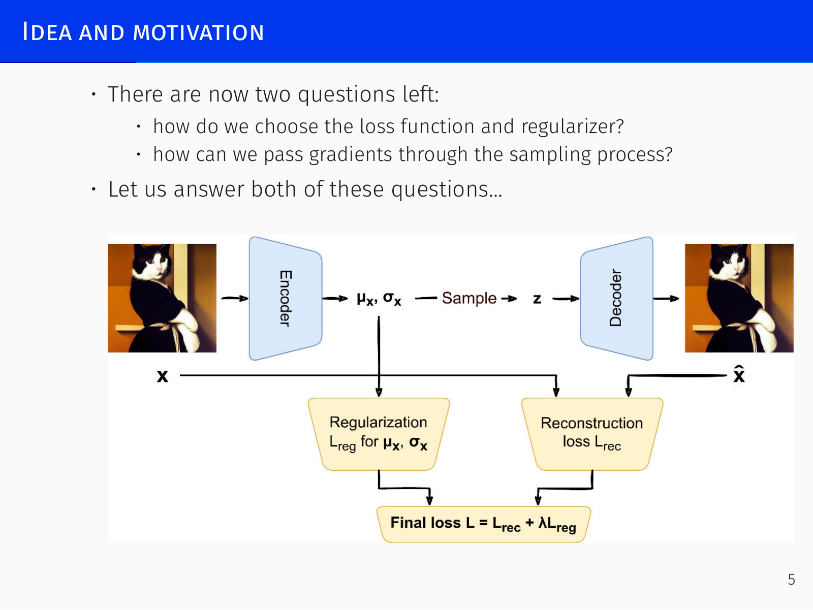
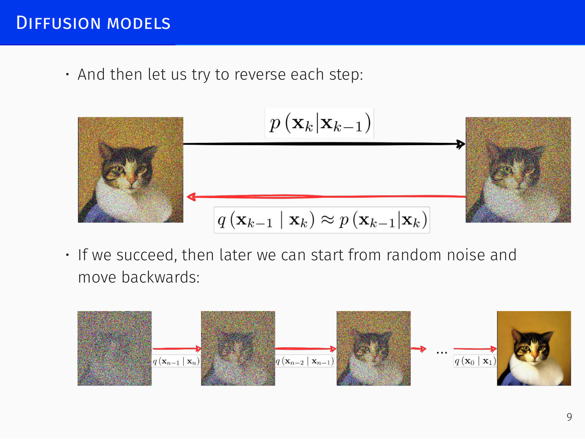

# VAE and Diffusion Models

## Variational Autoencoders *[00:02:37]*

### Idea and Motivation

A standard autoencoder maps every input \(x\) (e.g. an image) to a single latent code \(z\), and the decoder reconstructs \(\hat{x}\) from \(z\). This gives a compact representation but does **not** turn the decoder into a generative model: the latent codes live on a thin manifold inside \(z\)-space, and a randomly sampled point almost never falls on that manifold. Consequently the decoder cannot produce plausible images from arbitrary codes.

The **variational autoencoder** (Kingma et al., 2013) solves this by making the encoder output an entire distribution \(q(z\mid x)\) instead of a single point. For a given input, the encoder produces parameters (e.g. mean \(\mu_x\) and diagonal variance \(\sigma_x^2\)) of a Gaussian; a latent code is then drawn from that distribution and passed to the decoder. The intuition is that the decoder must become stable to small perturbations of \(z\) – much like a denoising autoencoder – and that, after training, the Gaussian “bubbles” placed around different training points will overlap and densely cover the latent space. Later, drawing a random \(z\) from a simple prior (e.g. \(\mathcal{N}(0,I)\)) will almost surely land in a region that the decoder can handle.

However, left unconstrained, the encoder will cheat: it can push the means of different inputs far apart and shrink the variances to zero, effectively collapsing back to a deterministic autoencoder. Therefore we **must add a regularizer** that forces \(q(z\mid x)\) to stay close to a simple prior—the standard Gaussian \(\mathcal{N}(0,I)\). This yields two central questions:

1. What exact loss function and regularizer should we use?
2. How can gradients flow through the random sampling step during backpropagation?

### Variational Approximation *[16:24]*

The joint distribution of images \(x\) and latent codes \(z\) can be factorised in two ways:

\[
p(z)\,p(x\mid z) \;=\; p(x,z) \;=\; p(x)\,p(z\mid x)
\]

- \(p(x)\) is the complex, unknown distribution of real data (e.g., all cat pictures).
- \(p(z)\) is the simple prior we can sample from for generation, chosen as \(\mathcal{N}(0,I)\).
- \(p(z\mid x)\) is the true encoder distribution – what the encoder would need to output to reconstruct perfectly.
- \(p(x\mid z)\) is the decoder distribution; we model it as a Gaussian whose mean is the decoder output \(f(z)\) and whose variance is a fixed constant \(cI\): \(p(x\mid z)=\mathcal{N}\!\bigl(x\mid f(z),\,cI\bigr)\).

Because \(p(x)\) is highly non-Gaussian, the true posterior \(p(z\mid x)\) will be complicated. Instead we approximate it with a simple distribution \(q(z\mid x)\), here chosen to be a diagonal Gaussian \(\mathcal{N}\!\bigl(z\mid \mu_x,\,\operatorname{diag}(\sigma_x^2)\bigr)\) whose parameters come from the encoder network. This is a **variational approximation** – replacing an intractable distribution by a tractable one.

#### Derivation of the Evidence Lower Bound (ELBO)

Starting from the identity \(\log p(x,z)=\log p(x)+\log p(z\mid x)\), rearrange:

\[
\log p(x) = \log p(x,z) - \log p(z\mid x).
\]

Take the expectation with respect to an arbitrary distribution \(q(z)\) (our approximation). Since \(\log p(x)\) does not depend on \(z\),

\[
\log p(x) = \mathbb{E}_{q(z)}\!\bigl[\log p(x,z)\bigr] - \mathbb{E}_{q(z)}\!\bigl[\log p(z\mid x)\bigr].
\]

Add and subtract the entropy term \(\mathbb{E}_{q(z)}[\log q(z)]\):

\[
\begin{aligned}
\log p(x) &=
\mathbb{E}_{q(z)}\!\bigl[\log p(x,z)\bigr] - \mathbb{E}_{q(z)}\!\bigl[\log q(z)\bigr]
\;+\; \mathbb{E}_{q(z)}\!\bigl[\log q(z)\bigr] - \mathbb{E}_{q(z)}\!\bigl[\log p(z\mid x)\bigr] \\[4pt]
&= \int q(z)\,\log\frac{p(x,z)}{q(z)}\,dz \;+\; \mathrm{KL}\!\bigl(q(z)\,\|\,p(z\mid x)\bigr).
\end{aligned}
\]

Define the **evidence lower bound (ELBO)**:

\[
\mathcal{L}(q) \;=\; \int q(z)\,\log\frac{p(x,z)}{q(z)}\,dz .
\]

Because the KL divergence is non-negative, \(\mathcal{L}(q) \le \log p(x)\), and maximising \(\mathcal{L}(q)\) w.r.t. \(q\) simultaneously minimises \(\mathrm{KL}(q(z)\,\|\,p(z\mid x))\) – i.e. it makes \(q\) a good approximation to the true posterior. In practice we substitute our specific model, which yields the concrete loss.

Substituting \(p(x,z)=p(z)\,p(x\mid z)\) and the chosen forms:

\[
\begin{aligned}
\mathcal{L}(q)
&= \int q(z)\,\log\frac{p(z)\,\mathcal{N}(x\mid f(z),cI)}{q(z)}\,dz \\[4pt]
&= \mathbb{E}_{q(z)}\bigl[\log p(x\mid z)\bigr] \;-\; \mathrm{KL}\!\bigl(q(z)\,\|\,p(z)\bigr).
\end{aligned}
\]

The first term expands to \(-\frac{1}{2c}\,\mathbb{E}_{q(z)}\!\bigl[\|x-f(z)\|^2\bigr]\) plus a constant – the **reconstruction loss** (mean squared error). The second term is the **regularizer**: it measures how far the approximate posterior is from the prior \(\mathcal{N}(0,I)\).

For a Gaussian \(q(z\mid x) = \mathcal{N}\!\bigl(z\mid \mu_x,\,\operatorname{diag}(\sigma_x^2)\bigr)\) and prior \(p(z)=\mathcal{N}(0,I)\), the KL divergence has a closed form:

\[
\mathrm{KL}\!\bigl(q(z)\,\|\,p(z)\bigr) =
\frac{1}{2}\sum_{j=1}^{d}\bigl(\sigma_{x,j}^2 + \mu_{x,j}^2 - \log\sigma_{x,j}^2 - 1\bigr).
\]

Thus the full VAE loss (to be minimised) becomes

\[
\mathcal{L}_{\text{VAE}}(x) =
\frac{1}{2c}\,\mathbb{E}_{q(z)}\!\bigl[\|x-f(z)\|^2\bigr]
\;+\;
\frac{1}{2}\sum_{j=1}^{d}\bigl(\sigma_{x,j}^2 + \mu_{x,j}^2 - \log\sigma_{x,j}^2 - 1\bigr).
\]

The expectation over \(q(z)\) is approximated by one sample per data point (or mini‑batch) during training.

> **Key insight:** The variational bound does not arise from intuition or heuristics. It provides the **only** principled combination of reconstruction loss and regulariser that naturally emerges from the probabilistic model. Any hand‑crafted regulariser (e.g. a gamma prior on \(\sigma^2\)) would be just one of many ad‑hoc choices; here the form is forced by the requirement to minimise \(\mathrm{KL}(q\,\|\,p(z\mid x))\).

### Reparametrization Trick *[54:33]*

To backpropagate through the sampling step, VAE uses the **reparametrization trick**. Instead of drawing \(z \sim \mathcal{N}(\mu_x, \sigma_x^2)\) directly, we sample an auxiliary noise vector \(u \sim \mathcal{N}(0,I)\) and compute

\[
z = \mu_x + \sigma_x \odot u,
\]

where \(\odot\) is element‑wise multiplication. The randomness now enters through the fixed noise source \(u\), and the transformation from \((\mu_x, \sigma_x)\) to \(z\) is deterministic. Hence gradients flow naturally from the reconstruction loss back to \(\mu_x\) and \(\sigma_x\). This trick works for Gaussians (and some other continuous distributions) but not for every distribution.

**Training summary:**  
For each mini‑batch of images \(x\), the encoder outputs \(\mu_x\) and \(\sigma_x\). We draw a matching mini‑batch of \(u\sim\mathcal{N}(0,I)\), form \(z=\mu_x+\sigma_x\odot u\), compute the decoder output \(\hat{x}=f(z)\), and evaluate the sum of the reconstruction loss and the KL regulariser. We then optimise the encoder and decoder weights via gradient descent.

### Modern Usage

Initially VAEs were outperformed by other methods, but they later became central to many generative systems:

- **Discrete VAEs** (e.g. VQ‑VAE) produce a discrete latent code (a sequence of tokens), enabling transformer‑based latent‑to‑image generation. This was the core of DALL‑E (2020/2021), which treated text‑conditioned image generation as machine translation from text tokens to image tokens.
- **Latent diffusion models** (see below) operate in the latent space of a pretrained (often discrete) autoencoder to avoid the huge cost of diffusing in pixel space. Thus modern diffusion models *rely* on a VAE as their first stage.

---

## Diffusion Models *[1:08:13]*

### Introduction

The idea, introduced by Sohl‑Dickstein et al. (2015), comes from non‑equilibrium thermodynamics: train a model that can reverse a gradual noising process. The forward chain progressively corrupts a data sample \(x_0\) by repeatedly adding small amounts of Gaussian noise; after many steps the result is indistinguishable from pure noise. If we can learn to undo each noising step, we obtain a generative model: starting from random noise and applying the learned reverse chain reproduces a sample from the data distribution.

### Forward Diffusion Process

Let data be \(x_0\sim p(x_0)\). At each step \(t\) we add noise:

\[
q(x_t\mid x_{t-1}) = \mathcal{N}\!\bigl(x_t\mid \sqrt{1-\beta_t}\,x_{t-1},\; \beta_t I\bigr),
\]

where \(\beta_t\) is a small constant (the noise schedule). Over \(T\) steps the joint distribution is

\[
q(x_{1:T}\mid x_0) = \prod_{t=1}^T q(x_t\mid x_{t-1}).
\]

Thanks to the reparametrization trick we can jump directly to any step \(t\) without simulating the chain repeatedly. Define \(\alpha_t = 1-\beta_t\) and \(A_t = \prod_{i=1}^t \alpha_i\). Then

\[
x_t = \sqrt{A_t}\,x_0 + \sqrt{1-A_t}\,\epsilon,\qquad \epsilon\sim\mathcal{N}(0,I),
\]

so the marginal distribution is

\[
q(x_t\mid x_0) = \mathcal{N}\!\bigl(x_t\mid \sqrt{A_t}\,x_0,\; (1-A_t)I\bigr).
\]

### Reverse Diffusion and Variational Lower Bound

If the forward steps are small (\(\beta_t\) tiny), the reverse distributions \(q(x_{t-1}\mid x_t)\) are also Gaussian – but their parameters depend on the full data distribution, which we do not know. We therefore learn a parametric reverse process:

\[
p_\theta(x_{0:T}) = p_\theta(x_T)\prod_{t=1}^T p_\theta(x_{t-1}\mid x_t),\qquad
p_\theta(x_{t-1}\mid x_t) = \mathcal{N}\!\bigl(x_{t-1}\mid \mu_\theta(x_t,t),\; \Sigma_\theta(x_t,t)\bigr).
\]

If we additionally know \(x_0\), the reverse step can be computed exactly. Conditioning on \(x_0\) gives

\[
q(x_{t-1}\mid x_t, x_0) = \mathcal{N}\!\bigl(x_{t-1}\mid \tilde{\mu}(x_t,x_0),\; \tilde{\beta}_t I\bigr),
\]

with

\[
\tilde{\beta}_t = \frac{1-A_{t-1}}{1-A_t}\,\beta_t,
\qquad
\tilde{\mu}(x_t,x_0) =
\frac{\sqrt{\alpha_t}(1-A_{t-1})}{1-A_t}\,x_t \;+\;
\frac{\sqrt{A_{t-1}}\beta_t}{1-A_t}\,x_0 .
\]

Using the reparametrisation \(x_t = \sqrt{A_t}\,x_0 + \sqrt{1-A_t}\,\epsilon_t\), this simplifies to

\[
\tilde{\mu}(x_t,x_0) = \frac{1}{\sqrt{\alpha_t}}\Bigl(x_t - \frac{1-\alpha_t}{\sqrt{1-A_t}}\,\epsilon_t\Bigr).
\]

The goal of training is to approximate this true reverse mean without knowing \(x_0\). This is done by a variational bound analogous to the VAE’s ELBO. The loss is

\[
L = \mathbb{E}_{q(x_{0:T})}\!\Bigl[\log\frac{q(x_{1:T}\mid x_0)}{p_\theta(x_{0:T})}\Bigr]
\;\geq\; -\mathbb{E}_{q(x_0)}[\log p_\theta(x_0)],
\]

which decomposes into a sum of per‑step terms:

\[
L = \underbrace{\mathrm{KL}\!\bigl(q(x_T\mid x_0)\,\|\,p_\theta(x_T)\bigr)}_{L_T}
\;+\; \sum_{t=1}^{T-1} \underbrace{\mathrm{KL}\!\bigl(q(x_t\mid x_{t+1},x_0)\,\|\,p_\theta(x_t\mid x_{t+1})\bigr)}_{L_t}
\;-\; \underbrace{\log p_\theta(x_0\mid x_1)}_{L_0}.
\]

Each term is a KL divergence between two Gaussians, giving closed‑form expressions. During training we parametrise

\[
p_\theta(x_{t-1}\mid x_t) =
\mathcal{N}\!\Bigl(x_{t-1}
\,\Big|\,
\frac{1}{\sqrt{\alpha_t}}\bigl(x_t - \frac{1-\alpha_t}{\sqrt{1-A_t}}\,\epsilon_\theta(x_t,t)\bigr),\;
\Sigma_\theta(x_t,t)\Bigr),
\]

so the network \(\epsilon_\theta\) directly predicts the noise \(\epsilon_t\) that was added in the forward pass.

### DDPM (Denoising Diffusion Probabilistic Models)

Ho et al. (2020) refined this framework into **DDPM**, which achieved generation quality comparable to the best GANs of the time. Key practical choices:

- The forward variances \(\beta_t\) are fixed, so \(L_T\) is a constant and can be ignored.
- The intermediate variances \(\Sigma_\theta(x_t,t)\) are also untrained; the loss simplifies to just the \(L_t\) terms.
- The final decoding step \(L_0\) is modelled with a discrete decoder that integrates the continuous Gaussian over pixel bins (for 8‑bit images scaled to \([-1,1]\)).

DDPM still required running the full chain of \(T\) steps (hundreds) to generate one image, making sampling 1000× slower than a comparable GAN.

### DDIM (Denoising Diffusion Implicit Models)

Song et al. (2020) addressed the speed problem. Their crucial observation: the loss \(L\) depends only on the marginals \(q(x_t\mid x_0)\), not on the full joint \(q(x_{1:T}\mid x_0)\). Therefore we can **design a different forward process** that shares the same marginals while allowing a faster reverse scheme.

DDIM defines a non‑Markovian forward process implicitly through its reverse transitions. The marginals stay unchanged, so the same ELBO can be used to train the reverse chain. The practical advantage comes from how the reverse steps are parametrised: instead of moving from \(x_t\) to \(x_{t-1}\) one noisy step at a time, DDIM directly predicts the noise \(\epsilon_t\) that relates \(x_t\) to \(x_0\), and then jumps toward \(x_0\) in larger, deterministic (or nearly deterministic) leaps. In effect it can skip intermediate steps, going from \(x_t\) to \(x_{t+k}\) in one move.

- **Speed:** 10×–100× faster than DDPM with no loss of quality.
- **Deterministic mode:** Setting the reverse variance to zero makes the generation mapping fully deterministic. Each initial noise \(x_T\) then corresponds to exactly one image, giving a well‑behaved latent representation. Smooth interpolations in noise space become possible—something impossible with the highly stochastic DDPM.

### Stable Diffusion

The next breakthrough was moving the diffusion process into a **lower‑dimensional latent space** instead of operating on pixels directly.

**Stable Diffusion** (Rombach, Blattmann et al., 2022) trains a diffusion model on latent codes obtained from a pretrained autoencoder (often a VQ‑VACE). The denoising network uses the encoded text prompt as conditioning via attention layers. Starting from random noise \(z_T\) and the conditioning signal, the denoising chain produces a clean latent code, which is then decoded into an image by the autoencoder’s decoder. This drastically cuts computational cost while preserving high quality and enabled large‑scale public text‑to‑image models.

### DALL‑E 2 (unCLIP)

**unCLIP** (Ramesh et al., 2022), better known as DALL‑E 2, factorises conditional generation as

\[
p(x\mid y) = p(x\mid c,y)\,p(c\mid y),
\]

where \(y\) is the text description and \(c\) a CLIP embedding. A prior model \(p(c\mid y)\) produces a CLIP vector from text, and a diffusion‑based decoder \(p(x\mid c,y)\) generates the image conditioned on both the text and the CLIP embedding. This enabled remarkable semantic quality for the time.

### Midjourney

Another powerful diffusion‑based image generator; its internal architecture is not publicly documented.

### Diffusion Transformers (DiT)

**DiT** (Peebles & Xie, 2022) replaces the U‑Net backbone of latent diffusion with a **transformer**. The input latent tensor is “patchified” into a sequence of tokens (like ViT), processed by transformer blocks that use adaptive layer normalisation conditioned on the diffusion time step. DiT models scale more efficiently than U‑Nets: transformer GFLOPS correlate strongly with generation quality, and large DiTs use compute more effectively.

### Flux

A successor of Stable Diffusion from the same team, with further improved image quality. Its exact architecture is also not fully public, but it is understood to be a latent diffusion model.

### Recent Developments

#### DPM‑Solver++

Lu et al. (2022) noticed that DDIM corresponds to a first‑order integration of the underlying ODE describing the diffusion process. By employing higher‑order ODE solvers (e.g., multistep second‑ or third‑order schemes), the local error is reduced, allowing even fewer reverse steps. DPM‑Solver++ is more stable and efficient than earlier solvers.

#### UniPC

Zhao et al. (2023) proposed a **predictor‑corrector** framework. A universal correcting step (UniC) can be appended to any predictor to raise the order of accuracy without extra model evaluations; the matching UniP predictor is derived accordingly.

#### Flow Matching

The most recent direction in generative modelling is **flow matching**, which frames generation as learning a continuous, invertible transformation between a simple base distribution and the data distribution. Many state‑of‑the‑art models now build on this approach. (Details are beyond the scope of this lecture.)

---

> **Summary of generative model taxonomy:**  
> – **Implicit density models** (GANs) remain useful in niche applications.  
> – **Explicit density models** include autoregressive models (WaveNet, LLMs), flow‑based models, and approximate density models. **Variational Autoencoders** and **Diffusion Models** fall into the last category: both avoid strong assumptions about the true data distribution and instead make assumptions about a variational approximation (to the encoder posterior in VAEs, and to the reverse denoising chain in diffusion models). Virtually all high‑profile generative models today are either autoregressive models or latent diffusion / VAE‑based architectures.
